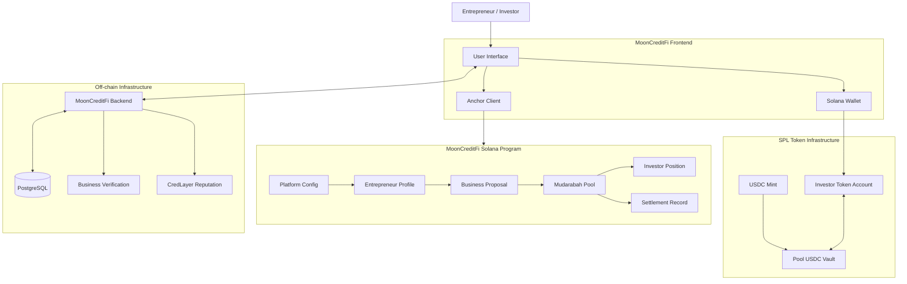
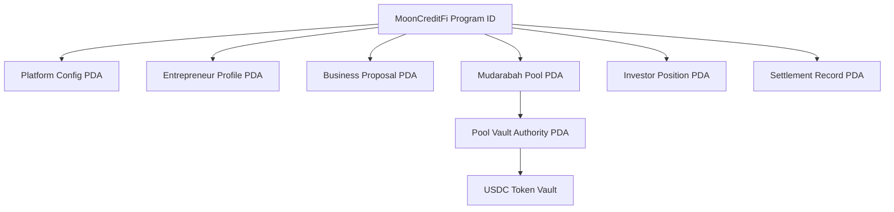
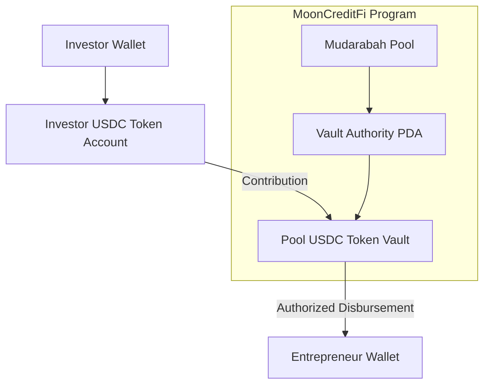
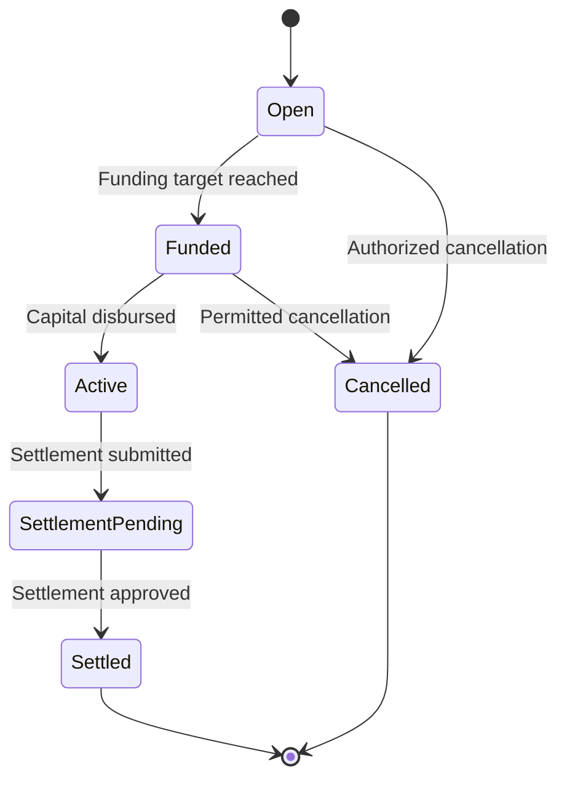
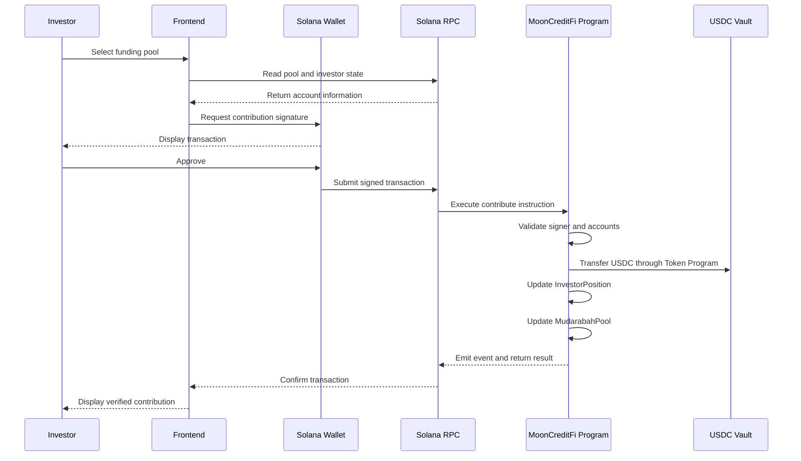
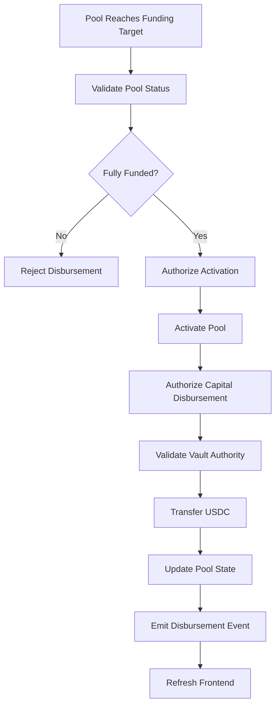
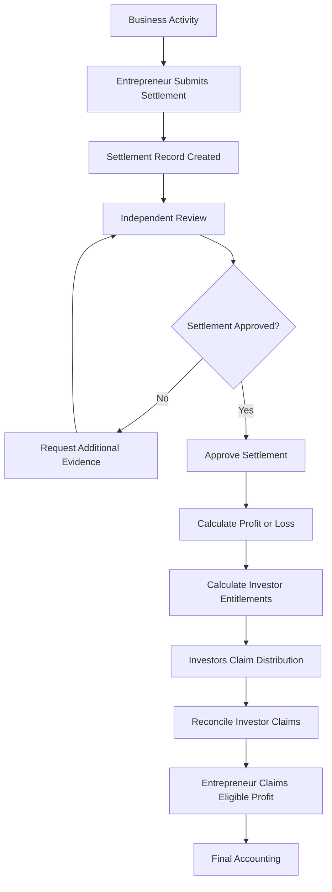
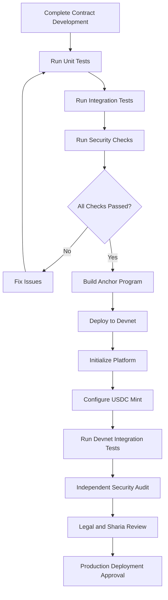

MoonCreditFi Blockchain & Rust Smart Contract Documentation
MoonCreditFi Contracts
(Documentation draft)

Trust Before Capital

Solana · Rust · Anchor Framework · SPL USDC · Program Derived Addresses
Blockchain

Solana Devnet architecture and transaction lifecycle

Smart contracts

Rust, Anchor instructions and account validation

USDC vaults

Investor contributions and controlled distributions

Security

PDA authority, validation, access control and testing

The following is a complete Markdown document you can save as:

docs/contracts/overview.mdx
:::writing{variant="document" id="82417"}
# MoonCreditFi Blockchain & Smart Contract Documentation

**Trust Before Capital**

Technical documentation for the MoonCreditFi Solana blockchain infrastructure and Rust smart contract system.

| Property | Details |
|---|---|
| Project | MoonCreditFi |
| Blockchain | Solana |
| Programming Language | Rust |
| Smart Contract Framework | Anchor |
| Token Standard | SPL Token |
| Settlement Asset | USDC |
| Initial Network | Solana Devnet |
| Account Architecture | Program Derived Addresses (PDAs) |
| Development Status | Development / Testing |
| Contract Repository | MoonCreditFi Contracts |

---

# 1. Introduction

## 1.1 Overview

MoonCreditFi is a reputation-informed, Mudarabah-based business financing platform built on Solana.

Its blockchain infrastructure provides transparent and programmable financial operations between entrepreneurs and investors.

The smart contract system manages the on-chain components of the financing lifecycle, including:

- Platform configuration.
- Entrepreneur registration.
- Financing proposal references.
- Mudarabah pool creation.
- Investor contributions.
- Capital disbursement.
- Settlement submission and approval.
- Profit and loss distribution.
- Investor claims.
- Pool cancellation and refunds.

The purpose of the blockchain layer is to make important financial operations verifiable, enforce agreed rules, and maintain an auditable transaction history.

The blockchain does not independently verify the truth of a business's financial reports or guarantee that disbursed capital will be recovered.

## 1.2 Core objectives

The MoonCreditFi smart contracts are designed to:

1. Provide transparent investment pool management.
2. Securely receive investor USDC contributions.
3. Maintain verifiable investment positions.
4. Enforce agreed Mudarabah profit-sharing rules.
5. Restrict access to authorized financial operations.
6. Provide predictable pool lifecycle transitions.
7. Prevent unauthorized fund withdrawals.
8. Record settlement and distribution activities.
9. Provide traceable blockchain events.
10. Support future expansion of the financing infrastructure.

---

# 2. Blockchain Architecture

## 2.1 Technology stack

| Technology | Responsibility |
|---|---|
| Solana | Blockchain execution environment |
| Rust | Smart contract programming language |
| Anchor | Solana program development framework |
| SPL Token | USDC token operations |
| Program Derived Addresses | Deterministic program-controlled accounts |
| Solana RPC | Blockchain communication |
| TypeScript | Frontend and contract client integration |
| Anchor IDL | Program interface description |

The initial implementation targets Solana Devnet.

Mainnet deployment must only happen after the required security, legal, operational, and financial reviews.

## 2.2 High-level blockchain architecture



## 2.3 Responsibilities of each layer

### Frontend

The frontend allows users to:

- Connect wallets.
- Review business proposals.
- Review financing terms.
- Sign transactions.
- Contribute USDC.
- Track investment positions.
- View transaction confirmations.

### Solana smart contract

The program enforces on-chain rules, including:

- Account ownership.
- Signer authorization.
- Pool status transitions.
- Contribution limits.
- Vault authority.
- Claim eligibility.
- Distribution calculations.

### Backend

The backend manages off-chain information, including:

- User profiles.
- Business information.
- Verification documents.
- Business review processes.
- Private records.
- Reputation service integration.
- Notifications.

The backend and smart contract must have clearly defined responsibilities. Neither should silently overwrite or misrepresent the authoritative state of the other.

---

# 3. Smart Contract Architecture

## 3.1 Program structure

The Anchor program should organize its functionality into clear modules.

Recommended organization:

```text
mooncreditfi-anchor/
│
├── Anchor.toml
├── Cargo.toml
├── package.json
│
├── programs/
│   └── mooncreditfi/
│       │
│       ├── Cargo.toml
│       │
│       └── src/
│           ├── lib.rs
│           │
│           ├── state/
│           │   ├── config.rs
│           │   ├── entrepreneur.rs
│           │   ├── proposal.rs
│           │   ├── pool.rs
│           │   ├── investor_position.rs
│           │   └── settlement.rs
│           │
│           ├── instructions/
│           │   ├── initialize_platform.rs
│           │   ├── register_entrepreneur.rs
│           │   ├── create_proposal.rs
│           │   ├── approve_proposal.rs
│           │   ├── create_pool.rs
│           │   ├── contribute.rs
│           │   ├── activate_pool.rs
│           │   ├── disburse_capital.rs
│           │   ├── submit_settlement.rs
│           │   ├── approve_settlement.rs
│           │   ├── claim_distribution.rs
│           │   ├── claim_entrepreneur_profit.rs
│           │   ├── cancel_pool.rs
│           │   └── claim_refund.rs
│           │
│           ├── errors.rs
│           ├── events.rs
│           └── constants.rs
│
└── tests/
    └── mooncreditfi.ts
```

This is a recommended modular structure. The current program may still have most logic in `lib.rs`; the actual source repository determines which modules exist.

## 3.2 Program entry point

The Anchor program exposes instructions through its program entry point.

Conceptually:

```rust
use anchor_lang::prelude::*;

declare_id!("YOUR_DEPLOYED_PROGRAM_ID");

#[program]
pub mod mooncreditfi {
    use super::*;

    pub fn initialize_platform(
        ctx: Context<InitializePlatform>,
    ) -> Result<()> {
        // Initialize platform configuration.
        Ok(())
    }

    pub fn register_entrepreneur(
        ctx: Context<RegisterEntrepreneur>,
    ) -> Result<()> {
        // Register entrepreneur.
        Ok(())
    }

    pub fn create_proposal(
        ctx: Context<CreateProposal>,
        // Add actual arguments.
    ) -> Result<()> {
        // Create financing proposal.
        Ok(())
    }
}
```

This is an illustrative example, not a replacement for the actual program source.

---

# 4. On-chain Account Architecture

The smart contract uses program-owned accounts to maintain financial and operational state.

## 4.1 PlatformConfig

The platform configuration account contains global program settings.

Proposed fields:

| Field | Type | Purpose |
|---|---|---|
| authority | Pubkey | Authorized platform administrator |
| usdc_mint | Pubkey | Approved USDC mint |
| bump | u8 | PDA bump |
| paused | bool | Emergency pause state, if implemented |
| version | u8 | Configuration version |

Responsibilities:

- Store platform authority.
- Identify the accepted USDC mint.
- Define global configuration.
- Support controlled configuration updates.

The authority must not have unrestricted access to investor funds.

For production, privileged actions should be governed by an appropriately configured multisig.

## 4.2 EntrepreneurProfile

Represents an entrepreneur's on-chain registration.

Proposed fields:

| Field | Type |
|---|---|
| entrepreneur | Pubkey |
| profile_id | u64 |
| bump | u8 |

The complete business profile and sensitive business information should remain in the backend.

The on-chain profile should contain only information necessary for contract operations.

## 4.3 BusinessProposal

Represents an approved or submitted financing proposal.

Proposed fields:

| Field | Type |
|---|---|
| entrepreneur | Pubkey |
| proposal_id | u64 |
| requested_amount | u64 |
| approved | bool |
| bump | u8 |

The proposal can reference off-chain business information using a stable identifier or content reference, but sensitive documents must not be placed directly on-chain.

## 4.4 MudarabahPool

Represents a dedicated business financing pool.

Proposed fields:

| Field | Type |
|---|---|
| proposal | Pubkey |
| entrepreneur | Pubkey |
| mint | Pubkey |
| funding_target | u64 |
| total_contributed | u64 |
| total_returned | u64 |
| investor_profit_bps | u16 |
| entrepreneur_profit_bps | u16 |
| status | PoolStatus |
| bump | u8 |

All monetary values are represented using integer token base units.

USDC normally uses six decimal places, but the program must validate the actual configured mint decimals rather than blindly assuming a token configuration.

## 4.5 InvestorPosition

Tracks an investor's position in a financing pool.

Proposed fields:

| Field | Type |
|---|---|
| pool | Pubkey |
| investor | Pubkey |
| contribution | u64 |
| claimed_amount | u64 |
| claimed | bool |
| bump | u8 |

An investor should have a separately verifiable position for each pool.

The contract must prevent duplicate or unauthorized claims.

## 4.6 SettlementRecord

Represents the settlement information submitted for a financing pool.

Proposed fields:

| Field | Type |
|---|---|
| pool | Pubkey |
| entrepreneur | Pubkey |
| total_returned | u64 |
| approved | bool |
| bump | u8 |

A settlement must be associated with the correct pool and must only be approved by an authorized reviewer.

A settlement record does not independently prove that reported business results are genuine.

---

# 5. Program Derived Addresses (PDAs)

## 5.1 What is a PDA?

A Program Derived Address is a deterministic address generated using:

- A collection of seeds.
- A program ID.
- A bump value.

A PDA does not have a conventional private key.

The program that derives the PDA can authorize it as a signer during a cross-program invocation by supplying the correct seeds.

This allows the program to control accounts and token vault authorities without exposing a private key.

## 5.2 Proposed PDA structure

| Account | Suggested seeds |
|---|---|
| PlatformConfig | `["platform_config"]` |
| EntrepreneurProfile | `["entrepreneur", entrepreneur_pubkey]` |
| BusinessProposal | `["proposal", entrepreneur_pubkey, proposal_id]` |
| MudarabahPool | `["pool", proposal_pubkey]` |
| InvestorPosition | `["position", pool_pubkey, investor_pubkey]` |
| SettlementRecord | `["settlement", pool_pubkey]` |
| Pool vault authority | `["vault_authority", pool_pubkey]` |

These seeds are proposed design conventions. The actual seed definitions in the deployed source code are authoritative.

## 5.3 PDA architecture diagram



## 5.4 PDA security

Every instruction must validate the expected PDA.

For example, an investor position must be derived using the correct pool and investor addresses.

The program must not accept an arbitrary account merely because it has the expected data layout.

Anchor supports seed and bump constraints to validate PDA derivation before the instruction handler executes.

Official reference: https://solana.com/docs/core/pda/pda-accounts

---

# 6. USDC Vault Architecture

## 6.1 Overview

USDC is the intended initial settlement asset.

Each financing pool should have a dedicated program-controlled token vault.

Investors transfer USDC from their token accounts into the pool vault.

The program controls withdrawals through the vault authority PDA.

## 6.2 Vault structure



## 6.3 Contribution process

1. Investor selects a funding pool.
2. Frontend reads the pool state.
3. Investor specifies the contribution amount.
4. Frontend constructs the transaction.
5. Investor signs the transaction.
6. The Anchor program validates the accounts.
7. The program transfers USDC into the vault.
8. The investor position is updated.
9. An event records the contribution.

## 6.4 Token validation

The program must verify:

- The accepted mint is correct.
- The source token account belongs to the investor.
- The source account uses the expected mint.
- The vault uses the expected mint.
- The vault authority is the correct PDA.
- The token program is supported.
- The contribution amount is valid.
- The pool accepts contributions.
- The contribution does not exceed the remaining target.

Use checked token transfers where supported by the selected token program.

Do not assume that a token account is safe merely because the frontend supplied its address.

Official Anchor references:

- https://www.anchor-lang.com/docs/tokens/basics/create-token-account
- https://www.anchor-lang.com/docs/tokens/basics/transfer-tokens

---

# 7. Mudarabah Financial Model

## 7.1 Overview

MoonCreditFi uses a Mudarabah-inspired financing structure.

The participants have different responsibilities.

### Rabb-ul-Maal — Investor

- Provides the investment capital.
- Agrees to the proposed profit-sharing ratio.
- Bears genuine financial business losses in proportion to capital, subject to the applicable agreement and recognized exceptions.

### Mudarib — Entrepreneur

- Manages the business activity.
- Uses the contributed capital for the agreed business purpose.
- Provides settlement information.
- Receives the agreed share of realized profits.

The entrepreneur is not automatically responsible for genuine business losses unless the loss results from negligence, misconduct, fraud, or breach of the agreement, subject to legal and Sharia review.

## 7.2 Profit distribution

Assume:

- Total investor capital: 10,000 USDC.
- Total returned capital and profit: 12,000 USDC.
- Actual profit: 2,000 USDC.
- Investor profit share: 70%.
- Entrepreneur profit share: 30%.

Calculation:

```text
Total Profit = 12,000 - 10,000

Total Profit = 2,000 USDC

Investor Profit = 2,000 × 70%

Investor Profit = 1,400 USDC

Entrepreneur Profit = 2,000 × 30%

Entrepreneur Profit = 600 USDC
```

The investors collectively receive:

```text
10,000 + 1,400 = 11,400 USDC
```

The entrepreneur receives:

```text
600 USDC
```

These are illustrative calculations, not guaranteed returns.

## 7.3 Loss distribution

Assume:

- Total investor capital: 10,000 USDC.
- Actual returned capital: 8,000 USDC.
- Business loss: 2,000 USDC.

The available capital is distributed among investors proportionally to their contributions.

The entrepreneur receives no profit distribution in this example.

Any liability for negligence, misconduct, fraud, or contractual breach requires an appropriate determination and must not be inferred merely because a business failed to meet its target.

## 7.4 Integer arithmetic

Solana programs should not use floating-point numbers for financial calculations.

Use integer arithmetic and checked operations.

For example:

```rust
let profit = total_returned
    .checked_sub(total_contributed)
    .ok_or(MoonCreditError::InvalidSettlement)?;

let investor_profit = profit
    .checked_mul(investor_share_bps as u64)
    .ok_or(MoonCreditError::ArithmeticOverflow)?
    .checked_div(10_000)
    .ok_or(MoonCreditError::ArithmeticOverflow)?;
```

This is illustrative. A production implementation must also consider intermediate overflow, the exact share representation, and rounding policy.

Use basis points:

```text
100% = 10,000 basis points

70% = 7,000 basis points

30% = 3,000 basis points
```

Validate that the agreed profit-sharing ratios sum to the permitted total.

## 7.5 Rounding policy

Integer division can produce residual units.

The program must define:

- How investor profit is rounded.
- How investor loss is allocated.
- Who receives residual units.
- Whether dust remains claimable.
- How final vault reconciliation works.

Do not silently discard residual funds.

---

# 8. Pool Lifecycle

## 8.1 Pool statuses

Proposed lifecycle:

| Status | Meaning |
|---|---|
| Open | Accepting investor contributions |
| Funded | Funding target reached |
| Active | Capital has entered the business activity |
| SettlementPending | Settlement submitted for review |
| Settled | Settlement approved and distribution available |
| Cancelled | Pool cancelled under permitted conditions |

## 8.2 Lifecycle diagram



The contract must enforce valid transitions.

A pool should never transition backward from a completed settlement to an active funding state.

## 8.3 Pool funding rules

The program must:

- Reject zero contributions.
- Reject contributions exceeding the target.
- Prevent contributions after funding closes.
- Prevent unauthorized pool activation.
- Prevent repeated capital disbursement.
- Preserve investor positions.
- Maintain accurate pool totals.

The precise relationship between reaching the funding target and activating a pool must be explicitly defined in the contract.

---

# 9. Smart Contract Instructions

This section documents the intended program instruction interface. Exact arguments and account contexts must be confirmed against the Anchor source and generated IDL.

## 9.1 initialize_platform

Purpose:

Initializes the global platform configuration.

Responsibilities:

- Store platform authority.
- Configure the approved USDC mint.
- Initialize global settings.
- Prevent unauthorized reinitialization.

## 9.2 register_entrepreneur

Purpose:

Registers an entrepreneur on-chain.

Responsibilities:

- Validate the entrepreneur signer.
- Create the entrepreneur profile PDA.
- Store the required registration information.
- Prevent duplicate registration.

## 9.3 create_proposal

Purpose:

Creates a business financing proposal.

Responsibilities:

- Validate entrepreneur ownership.
- Validate the entrepreneur profile.
- Validate requested capital.
- Create the proposal PDA.
- Record the proposal details.

## 9.4 approve_proposal

Purpose:

Approves a submitted proposal.

Responsibilities:

- Verify the authorized reviewer.
- Verify the proposal exists.
- Prevent duplicate approval.
- Record the approval state.

## 9.5 create_pool

Purpose:

Creates a Mudarabah funding pool for an approved proposal.

Responsibilities:

- Validate proposal ownership.
- Validate approval state.
- Configure the funding target.
- Configure profit-sharing terms.
- Create the pool PDA.
- Initialize the pool vault.

## 9.6 contribute

Purpose:

Allows investors to contribute USDC.

Responsibilities:

- Validate investor signer.
- Validate pool status.
- Validate token mint.
- Validate investor token account.
- Validate vault authority.
- Transfer USDC into the vault.
- Create or update investor position.
- Update total contributions.
- Emit contribution event.

## 9.7 activate_pool

Purpose:

Moves a fully funded pool into its active state.

Responsibilities:

- Verify funding target is reached.
- Verify correct pool status.
- Verify authorized activation.
- Record activation.

The activation authority and exact activation conditions must be explicitly specified.

## 9.8 disburse_capital

Purpose:

Transfers the approved capital from the pool vault to the entrepreneur.

Responsibilities:

- Validate pool status.
- Validate entrepreneur destination.
- Validate token mint.
- Validate vault authority.
- Prevent duplicate disbursement.
- Transfer approved capital.
- Update the pool lifecycle.

Disbursement is an irreversible financial risk. A contract cannot guarantee that the entrepreneur will return funds after receiving them.

## 9.9 submit_settlement

Purpose:

Allows an entrepreneur to submit settlement information.

Responsibilities:

- Validate entrepreneur authorization.
- Validate pool state.
- Validate reported amounts.
- Create or update the permitted settlement record.
- Move the pool to settlement pending.

Off-chain evidence and review are necessary for determining whether the reported business results are credible.

## 9.10 approve_settlement

Purpose:

Allows an authorized reviewer to approve a settlement.

Responsibilities:

- Validate reviewer authority.
- Validate settlement ownership.
- Validate pool relationship.
- Validate settlement state.
- Record the approved return amount.
- Make the distribution process available.

Approval must not be granted solely because the entrepreneur submitted a number.

## 9.11 claim_distribution

Purpose:

Allows an investor to claim their eligible distribution.

Responsibilities:

- Validate investor ownership.
- Validate pool settlement state.
- Validate investor position.
- Calculate the investor's entitlement.
- Prevent duplicate claims.
- Transfer the correct amount.
- Record claim state.

## 9.12 claim_entrepreneur_profit

Purpose:

Allows the entrepreneur to claim their eligible share of realized profit.

Responsibilities:

- Validate entrepreneur ownership.
- Validate settlement approval.
- Ensure investor distributions are accounted for.
- Calculate the agreed entrepreneur profit share.
- Prevent duplicate claims.
- Transfer the eligible amount.

The implementation must define what happens when an investor never claims. It must not allow an entrepreneur to withdraw amounts still owed to investors.

## 9.13 cancel_pool

Purpose:

Cancels an eligible pool.

Responsibilities:

- Validate authorized cancellation.
- Verify cancellation conditions.
- Prevent cancellation after disbursement where not permitted.
- Update pool status.
- Enable eligible refunds.

## 9.14 claim_refund

Purpose:

Allows investors to recover refundable contributions from a cancelled pool.

Responsibilities:

- Validate investor position.
- Validate cancellation state.
- Calculate the refundable contribution.
- Prevent duplicate refunds.
- Transfer the eligible amount.
- Record refund status.

---

# 10. Transaction and Instruction Flow

## 10.1 Investor contribution



## 10.2 Capital disbursement



## 10.3 Settlement and distribution



---

# 11. Events and Error Handling

## 11.1 Events

The program should emit events for important state changes.

Recommended events:

- PlatformInitialized
- EntrepreneurRegistered
- ProposalCreated
- ProposalApproved
- PoolCreated
- ContributionMade
- PoolActivated
- CapitalDisbursed
- SettlementSubmitted
- SettlementApproved
- DistributionClaimed
- EntrepreneurProfitClaimed
- PoolCancelled
- RefundClaimed

Events should contain sufficient information for transaction indexing and application updates without exposing sensitive business information.

Events are not a substitute for reading and validating the actual on-chain account state.

## 11.2 Error categories

| Category | Example |
|---|---|
| Authorization | UnauthorizedAuthority |
| Account validation | InvalidPool |
| PDA validation | InvalidPda |
| Token validation | InvalidMint |
| Funding | FundingTargetExceeded |
| Pool state | InvalidPoolStatus |
| Settlement | SettlementNotApproved |
| Claims | AlreadyClaimed |
| Arithmetic | ArithmeticOverflow |
| Funds | InsufficientVaultBalance |

Use the actual error names from the deployed program in the final API and developer reference.

---

# 12. Smart Contract Security

Security is a fundamental requirement because the program handles investor capital.

## 12.1 Signer validation

Every sensitive instruction must validate the required signer.

Examples:

- An investor must authorize their own contribution.
- An entrepreneur must authorize their own proposal.
- An authorized reviewer must approve settlements.
- Platform configuration changes must require the proper governance authority.

Never rely on a wallet address supplied by the frontend as proof of authorization.

## 12.2 PDA validation

Validate all PDA accounts using the expected seeds and bump.

Ensure that:

- Pool addresses belong to the correct proposal.
- Investor positions belong to the correct investor and pool.
- Vault authority belongs to the correct pool.
- Settlement records reference the correct pool.

## 12.3 Token security

Validate:

- Mint addresses.
- Token account ownership.
- Vault authority.
- Token program.
- Transfer amounts.
- Token decimals.
- Source and destination accounts.

Use checked arithmetic for all monetary calculations.

## 12.4 Claim protection

Every claim must be protected against:

- Duplicate execution.
- Unauthorized callers.
- Incorrect investor positions.
- Wrong pool references.
- Incorrect settlement state.
- Over-withdrawal.
- Claim amount manipulation.

## 12.5 Administrative security

Administrative privileges should be limited.

Recommended production controls:

- Multisig governance.
- Explicit authority rotation.
- Restricted configuration changes.
- Upgrade authority governance.
- Emergency pause design.
- Transparent administrative events.
- Independent contract security review.

A stored authority public key is not itself a multisig.

## 12.6 Business and settlement risk

The contract cannot determine whether:

- A business is genuinely profitable.
- An entrepreneur submitted accurate financial statements.
- A business failed honestly.
- An entrepreneur committed fraud.
- A business has sufficient physical assets.

These require evidence, verification procedures, and appropriate legal processes outside the smart contract.

---

# 13. Testing Strategy

The smart contract must be tested beyond successful transaction scenarios.

## 13.1 Unit tests

Test:

- Account initialization.
- PDA derivation.
- Pool creation.
- Contribution calculations.
- Profit distribution.
- Loss allocation.
- Refund calculations.
- Claim calculations.
- Rounding behavior.
- Status transitions.

## 13.2 Integration tests

Test:

- Full entrepreneur registration.
- Proposal submission.
- Proposal approval.
- Pool initialization.
- Multiple investor contributions.
- Funding target enforcement.
- Capital disbursement.
- Settlement submission.
- Settlement approval.
- Investor distribution.
- Entrepreneur profit claim.
- Cancellation and refunds.

## 13.3 Negative tests

Test that the program rejects:

- Unauthorized signers.
- Invalid PDAs.
- Incorrect token mints.
- Incorrect vault authorities.
- Contributions above the target.
- Zero-value contributions.
- Duplicate claims.
- Invalid pool transitions.
- Unauthorized disbursements.
- Duplicate settlement approvals.
- Arithmetic overflow.
- Claims against unapproved settlements.

## 13.4 Financial invariants

The program should preserve these accounting principles:

1. Total investor contributions must match the recorded position totals.
2. Total distributions must never exceed funds available for distribution.
3. No investor may claim more than their calculated entitlement.
4. No investor may claim twice.
5. The entrepreneur must not claim funds owed to investors.
6. Cancelled pools must support only permitted refunds.
7. All financial operations must reconcile with the vault balance and the program's accounting model.

Use invariant and property-based tests where practical.

## 13.5 Testing environments

| Environment | Purpose |
|---|---|
| Local validator | Isolated contract testing |
| Solana Devnet | Integration testing |
| Solana Mainnet | Production deployment only after approvals |

Do not use real investor capital during development testing.

---

# 14. Development Setup

## 14.1 Prerequisites

- Rust toolchain.
- Cargo.
- Solana CLI.
- Anchor CLI.
- Node.js.
- Yarn or npm.
- Solana wallet.
- Devnet SOL.
- Devnet USDC test tokens.

Use the project-pinned dependency versions and `Cargo.lock` where applicable.

## 14.2 Clone repository

```bash
git clone <CONTRACT_REPOSITORY_URL>

cd mooncreditfi-anchor
```

## 14.3 Check installed tools

```bash
rustc --version

cargo --version

solana --version

anchor --version

node --version
```

## 14.4 Install dependencies

```bash
yarn install
```

Use the package manager configured by the repository.

## 14.5 Configure Solana Devnet

```bash
solana config set --url devnet
```

Check configuration:

```bash
solana config get
```

Check wallet:

```bash
solana address
```

Check balance:

```bash
solana balance
```

## 14.6 Build Anchor program

```bash
anchor build
```

## 14.7 Run tests

```bash
anchor test
```

Run the tests specified by the repository and verify that they cover the critical financial and security paths.

---

# 15. Deployment

## 15.1 Deployment lifecycle



## 15.2 Devnet deployment

Before deployment:

- Confirm the program ID.
- Confirm the selected USDC mint.
- Confirm the wallet and network.
- Confirm the program build.
- Review the upgrade authority.
- Confirm the deployment configuration.

Deploy using the configured Devnet environment:

```bash
anchor deploy --provider.cluster devnet
```

Verify the deployed program ID and transaction on a Solana explorer.

## 15.3 Production deployment requirements

Before Mainnet:

- Complete independent security audits.
- Review all privileged instructions.
- Test all financial edge cases.
- Confirm USDC mint configuration.
- Establish multisig governance.
- Define upgrade authority policy.
- Complete legal and regulatory reviews.
- Complete Sharia review before claiming Sharia compliance.
- Establish monitoring and incident response.
- Reconcile all financial accounting paths.

A successful Devnet deployment does not mean a contract is safe for real funds.

---

# 16. Frontend Integration

The frontend interacts with the Anchor program through its generated IDL and a compatible client library.

The integration should:

1. Load the correct program ID and IDL.
2. Connect to the correct Solana network.
3. Derive the required PDAs.
4. Fetch account data.
5. Construct instructions.
6. Request wallet signatures.
7. Submit transactions.
8. Confirm execution.
9. Refresh account state.
10. Display transaction results.

Example conceptual flow:

```typescript
// Illustrative only. Adapt to the actual generated IDL
// and installed Anchor client version.

const transaction = await program.methods
  .contribute(amount)
  .accounts({
    // Supply validated account addresses.
  })
  .transaction();

const signature = await wallet.sendTransaction(
  transaction,
  connection
);

await connection.confirmTransaction(
  signature,
  "confirmed"
);
```

The actual method signature and accounts must match the generated IDL.

Never hardcode assumptions about account ordering or instruction arguments when the generated IDL is available.

---

# 17. Known Limitations and Future Improvements

The following are important design considerations and potential improvements. They must not be represented as implemented unless confirmed in the source code.

- Emergency pause functionality.
- Multisig-controlled administrative operations.
- Authority rotation.
- Milestone-based disbursement.
- Funding deadlines.
- Expired-pool handling.
- Advanced settlement evidence references.
- Automated vault reconciliation.
- Residual token accounting.
- Investor claim expiration policy.
- Multiple approved token support.
- Token-2022 compatibility.
- Advanced event indexing.
- On-chain governance.
- Formal verification and property-based testing.

A particularly important design question is how to handle investors who never claim their distributions. The contract must define the treatment of unclaimed investor funds before production.

---

# 18. Important Financial and Technical Disclaimers

MoonCreditFi uses a Mudarabah-inspired financing model.

The smart contracts automate selected financial rules, but they do not independently establish whether a business is trustworthy, whether a loss is genuine, or whether a submitted settlement is truthful.

A blockchain transaction is evidence of an on-chain action. It is not proof of the underlying real-world business activity.

The platform must not promise guaranteed returns or guaranteed repayment.

Contract deployment, security auditing, legal approval, regulatory compliance, and Sharia review are separate requirements.

---

# 19. Conclusion

The MoonCreditFi blockchain infrastructure provides the programmable financial foundation for the platform.

The Rust and Anchor smart contracts are responsible for enforcing the on-chain rules governing:

- Entrepreneur and proposal records.
- Mudarabah pool creation.
- Investor USDC contributions.
- Capital disbursement.
- Settlement approval.
- Profit and loss allocation.
- Investor distributions.
- Refunds and accounting.

The long-term goal is to provide a transparent, secure, and auditable financing infrastructure for entrepreneurs and investors.

**MoonCreditFi — Trust Before Capital.**
:::2. Recommended individual contract documentation files
Don't keep everything in one huge page. Split the content into these pages so developers can navigate directly to the part they need.
docs/contracts/
│
├── overview.mdx
├── blockchain-architecture.mdx
├── installation.mdx
├── program-architecture.mdx
├── accounts-and-pdas.mdx
├── usdc-vault-architecture.mdx
├── instructions.mdx
├── investor-contributions.mdx
├── mudarabah-lifecycle.mdx
├── profit-and-loss-calculations.mdx
├── capital-disbursement.mdx
├── settlement-and-distribution.mdx
├── events-and-errors.mdx
├── security.mdx
├── testing.mdx
└── deployment.mdx

3. Critical architecture decisions to resolve
These are the issues I would challenge before calling the contract architecture production-ready.
Issue	Why it matters
Who approves settlements?	Determines who can authorize financial distributions.
Who controls capital disbursement?	Prevents unauthorized or premature withdrawals.
What happens to unclaimed investor funds?	Prevents the entrepreneur from claiming funds still owed to investors.
How are genuine losses verified?	A smart contract cannot independently verify business performance.
How is rounding dust handled?	Prevents unexplained residual funds.
Who controls program upgrades?	Protects investors from unilateral changes to program behavior.
What happens when an entrepreneur disappears?	Disbursement cannot guarantee recovery.


One important correction to the architecture: A pool vault should not simply be a wallet from which the administrator can withdraw funds. Its authority should be controlled by the program, with tightly validated instructions governing every transfer.
4. Technical references
These official references are useful when implementing and verifying the documentation:
- Solana — Program Derived Addresses
- Anchor — Account Constraints
- Anchor — Creating Token Accounts
- Anchor — Token Transfers
- Solana — Building Your First Anchor Program
