# MoonCreditFi Blockchain Architecture & Flowcharts

**Trust Before Capital**

Technical architecture documentation for the MoonCreditFi Solana blockchain infrastructure.

| Property | Details |
|---|---|
| Project | MoonCreditFi |
| Blockchain | Solana |
| Smart Contract Language | Rust |
| Framework | Anchor |
| Token | USDC |
| Network | Solana Devnet |
| Architecture | Program-based financial infrastructure |
| Status | Development |

---

# 1. Overview

MoonCreditFi uses Solana smart contracts to manage the on-chain components of a Mudarabah-based business financing system.

The blockchain architecture connects four major participants and components:

1. Entrepreneurs — Submit business financing proposals.
2. Investors — Contribute USDC to financing pools.
3. MoonCreditFi Smart Contracts — Enforce financial rules and manage on-chain state.
4. Backend Infrastructure — Handles business information, verification, private documents, and off-chain services.

The architecture separates business information and verification from financial operations executed on-chain.

The Solana program controls the financial rules and token movements that are implemented in the contracts.

# 2. High-Level System Architecture

The MoonCreditFi system consists of three major infrastructure layers:

- Frontend application.
- Backend services.
- Solana blockchain.

## 2.1 Overall architecture diagram


[Mermaid source](diagrams/architecture-and-flowcharts-01.mmd)

## 2.2 Architecture responsibilities

| Layer | Responsibility |
|---|---|
| Frontend | User interaction, dashboards, transaction initiation |
| Backend | Profiles, business data, verification and private records |
| Solana | Financial state and program-enforced operations |
| Wallet | Authentication signatures and transaction authorization |
| CredLayer | Reputation and wallet risk signals |

The backend must not be treated as the authority for actual on-chain balances.

Likewise, the blockchain cannot independently establish whether submitted business information is truthful.

# 3. Smart Contract Architecture

The MoonCreditFi Anchor program is the core on-chain financial engine.

It manages the relationship between platform configuration, entrepreneurs, financing proposals, pools, investors, and settlements.

## 3.1 Program account architecture


[Mermaid source](diagrams/architecture-and-flowcharts-02.mmd)

## 3.2 Account responsibilities

| Account | Responsibility |
|---|---|
| PlatformConfig | Stores global platform configuration |
| EntrepreneurProfile | Represents an entrepreneur on-chain |
| BusinessProposal | Represents a financing proposal |
| MudarabahPool | Maintains pool financial state |
| InvestorPosition | Tracks an investor's contribution and claim |
| SettlementRecord | Records settlement submission and approval |
| Vault Authority | Controls the pool vault through PDA signing |
| USDC Vault | Holds pool USDC tokens |

The vault authority is a PDA used to authorize token transfers. The USDC vault itself is a token account.

## 3.3 Account relationships


[Mermaid source](diagrams/architecture-and-flowcharts-03.mmd)

This diagram describes the intended logical relationships. The actual account fields and cardinalities must be reconciled with the Anchor implementation.

# 4. PDA Architecture

Program Derived Addresses provide deterministic account addresses controlled by the MoonCreditFi program.

## 4.1 PDA derivation flow


[Mermaid source](diagrams/architecture-and-flowcharts-04.mmd)

## 4.2 Proposed PDA seeds

| Account | Seeds |
|---|---|
| PlatformConfig | `platform_config` |
| EntrepreneurProfile | `entrepreneur + entrepreneur_pubkey` |
| BusinessProposal | `proposal + entrepreneur_pubkey + proposal_id` |
| MudarabahPool | `pool + proposal_pubkey` |
| InvestorPosition | `position + pool_pubkey + investor_pubkey` |
| SettlementRecord | `settlement + pool_pubkey` |
| Vault Authority | `vault_authority + pool_pubkey` |

The actual program seed definitions are authoritative.

# 5. Entrepreneur Financing Flow

This flow explains how an entrepreneur moves from account authentication to an approved financing opportunity.

## 5.1 Entrepreneur journey


[Mermaid source](diagrams/architecture-and-flowcharts-05.mmd)

## 5.2 Important separation

Business verification and financing proposal approval are separate operations.

A verified business is not automatically entitled to funding.

A financing proposal must undergo its own review and approval process.

# 6. Investor Funding Flow

This flow explains how an investor discovers a financing opportunity and contributes USDC.

## 6.1 Investor journey


[Mermaid source](diagrams/architecture-and-flowcharts-06.mmd)

## 6.2 Contribution architecture


[Mermaid source](diagrams/architecture-and-flowcharts-07.mmd)

Every contribution must be validated by the program. Frontend validation is only for user experience and is not a substitute for on-chain validation.

# 7. Mudarabah Pool Lifecycle

The Mudarabah pool manages the lifecycle of business financing.

## 7.1 State transition diagram


[Mermaid source](diagrams/architecture-and-flowcharts-08.mmd)

## 7.2 Lifecycle explanation

| Status | Description |
|---|---|
| Open | Pool accepts investor contributions |
| Funded | Funding target reached |
| Active | Capital has been disbursed |
| SettlementPending | Settlement awaits approval |
| Settled | Settlement approved and distribution can proceed |
| Cancelled | Pool cancelled under permitted conditions |

The program must enforce valid transitions and prevent unauthorized status changes.

# 8. Capital Disbursement Flow

Once the pool has reached its funding target, the approved capital may be transferred to the entrepreneur.

## 8.1 Disbursement diagram


[Mermaid source](diagrams/architecture-and-flowcharts-09.mmd)

The contract must prevent a second disbursement for the same pool.

# 9. Settlement Architecture

After the entrepreneur completes the agreed business activity, settlement information is submitted for review.

The contract records the settlement and enforces the authorized approval process.

## 9.1 Settlement flow


[Mermaid source](diagrams/architecture-and-flowcharts-10.mmd)

## 9.2 Off-chain and on-chain separation

| Operation | Location |
|---|---|
| Business financial documents | Private backend storage |
| Business evidence review | Off-chain review process |
| Settlement submission | Backend and blockchain as designed |
| Settlement approval | Authorized on-chain instruction |
| Distribution calculations | Smart contract |
| Token transfers | Solana |
| Transaction records | Solana |

An approved settlement means an authorized reviewer accepted the submitted information. It does not make the underlying business figures independently proven facts.

# 10. Profit and Loss Distribution Flow

The distribution process depends on the settlement outcome.

## 10.1 Profit scenario


[Mermaid source](diagrams/architecture-and-flowcharts-11.mmd)

## 10.2 Loss scenario


[Mermaid source](diagrams/architecture-and-flowcharts-12.mmd)

In a genuine Mudarabah business loss, investors generally bear the financial capital loss, while the entrepreneur loses their effort and expected profit. Negligence, misconduct, fraud, or breach must be addressed through an appropriate determination.

# 11. Complete End-to-End System Flow

The following diagram brings the entire MoonCreditFi financing lifecycle together.


[Mermaid source](diagrams/architecture-and-flowcharts-13.mmd)

# 12. Architecture Boundaries and Security

The following responsibilities must remain clearly separated.

| Responsibility | Authoritative layer |
|---|---|
| Wallet signature | Wallet cryptographic verification |
| Authentication session | Backend |
| User profile | Backend database |
| Business documents | Private backend storage |
| Business verification | Authorized review process |
| Reputation signals | CredLayer service |
| Pool financial state | Solana program |
| Investor position | Solana program |
| USDC vault balance | Solana token account |
| Capital disbursement | Solana program |
| Settlement review decision | Authorized reviewer |
| Distribution entitlement | Solana program |
| Transaction confirmation | Solana RPC and on-chain state |

## 12.1 Security principles

- Validate every signer.
- Validate every PDA.
- Validate token mint and token accounts.
- Use program-controlled vault authorities.
- Prevent duplicate claims.
- Prevent unauthorized withdrawals.
- Use checked arithmetic.
- Protect investor funds from arbitrary administrative withdrawal.
- Use multisig governance for privileged production operations.
- Maintain a clear audit trail.
- Do not trust frontend-submitted financial state.

# 13. Architecture Summary

MoonCreditFi separates its blockchain infrastructure into distinct responsibilities:

**Entrepreneur layer:** Business registration and financing proposals.

**Investor layer:** Opportunity discovery and USDC contributions.

**Smart contract layer:** Pool management, fund custody, capital disbursement, settlement authorization, and distributions.

**Backend layer:** Business information, verification, documents, reputation, and other off-chain services.

**Blockchain layer:** Verifiable financial transactions and program-enforced state transitions.

The result is a financing architecture in which off-chain business processes interact with transparent on-chain financial operations.

