# MoonCreditFi Blockchain Architecture & Flowcharts

**Trust Before Capital**

Technical architecture and workflow documentation for MoonCreditFi's Solana blockchain infrastructure.

| Property | Details |
|---|---|
| Project | MoonCreditFi |
| Blockchain | Solana |
| Smart Contract | Rust + Anchor |
| Token Standard | SPL Token |
| Settlement Asset | USDC |
| Network | Solana Devnet |
| State Management | Program Derived Addresses (PDAs) |
| Primary Workflow | Mudarabah Business Financing |
| Documentation Type | Blockchain Architecture & Flowcharts |

---

# 1. Architecture Overview

MoonCreditFi uses a hybrid blockchain architecture that separates on-chain financial execution from off-chain application services.

The Solana program manages financial operations and enforces the rules governing investor contributions, funding pools, capital disbursement, settlements, and distributions.

The frontend provides the interface through which entrepreneurs and investors interact with the protocol.

The backend manages application data, user profiles, business information, verification processes, and other off-chain services.

## 1.1 High-Level Architecture

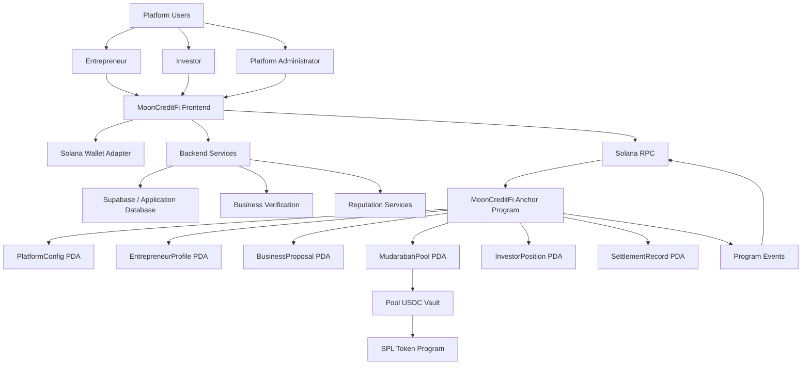

## 1.2 Architecture Responsibilities

| Layer | Responsibility |
|---|---|
| Frontend | User interaction, wallet connection, transaction construction |
| Wallet | Transaction and message signing |
| Backend | User profiles, business information, verification and application services |
| Supabase | Off-chain application data |
| Solana RPC | Blockchain communication and account retrieval |
| Anchor Program | Financial rules and instruction execution |
| PDAs | Program-controlled state and deterministic account addresses |
| SPL Token Program | USDC token transfers |
| USDC Vault | Holds pool contributions and settlement funds |

**Important:** The frontend and backend do not independently authorize blockchain transactions. The smart contract validates the supplied accounts and required signatures when instructions execute.

---

# 2. On-chain Account Architecture

MoonCreditFi uses program-owned accounts to represent the platform's financial and operational state.

## 2.1 Account Relationship Diagram

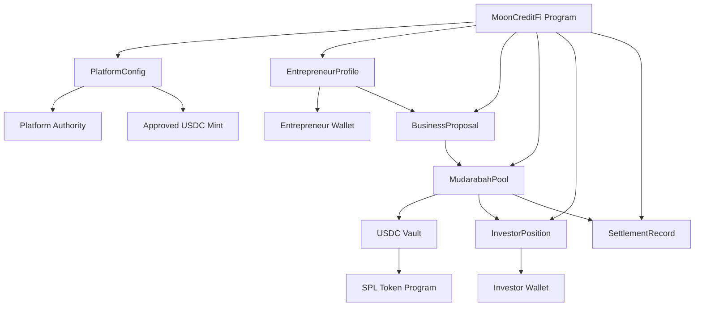

## 2.2 Account Descriptions

| Account | Purpose |
|---|---|
| PlatformConfig | Stores global platform configuration and authority |
| EntrepreneurProfile | Represents an entrepreneur's on-chain registration |
| BusinessProposal | Stores financing proposal information |
| MudarabahPool | Stores pool funding and settlement state |
| InvestorPosition | Tracks an investor's contribution and claim status |
| SettlementRecord | Stores submitted and approved settlement information |
| USDC Vault | Holds the USDC associated with a financing pool |

These relationships describe the documented architecture. Exact account fields and constraints must be checked against the deployed Rust source and IDL.

---

# 3. PDA Architecture

Program Derived Addresses provide deterministic account locations and allow the program to authorize specific operations without maintaining a conventional private key for each PDA.

## 3.1 PDA Derivation Flow

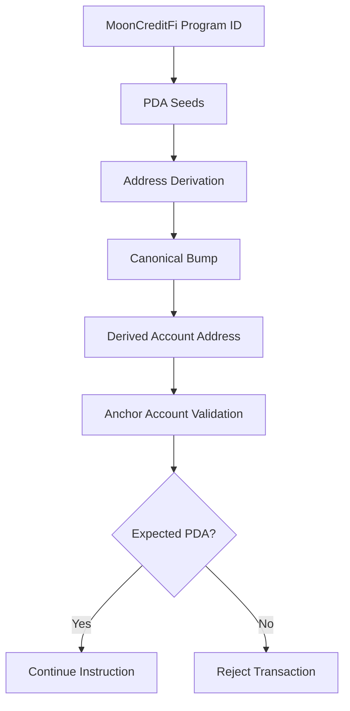

## 3.2 Documented PDA Design

| Account | Suggested Seeds |
|---|---|
| PlatformConfig | `["platform_config"]` |
| EntrepreneurProfile | `["entrepreneur", entrepreneur_pubkey]` |
| BusinessProposal | `["proposal", entrepreneur_pubkey, proposal_id]` |
| MudarabahPool | `["pool", proposal_pubkey]` |
| InvestorPosition | `["position", pool_pubkey, investor_pubkey]` |
| SettlementRecord | `["settlement", pool_pubkey]` |
| Pool vault authority | `["vault_authority", pool_pubkey]` |

These are the proposed seed conventions in the architecture draft. The actual deployed program's seed definitions are authoritative.

## 3.3 PDA Security Flow

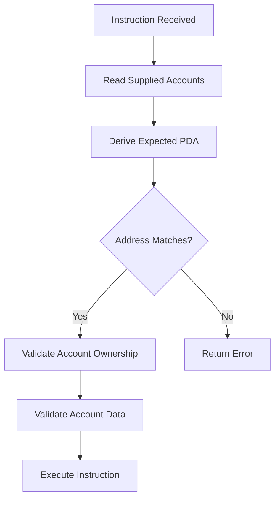

---

# 4. USDC Vault Architecture

Each financing pool is intended to have a dedicated USDC vault controlled through the program's PDA authority.

Investors contribute USDC to the vault. When the relevant conditions are satisfied, the program can authorize transfers through the SPL Token Program.

## 4.1 Vault Relationship

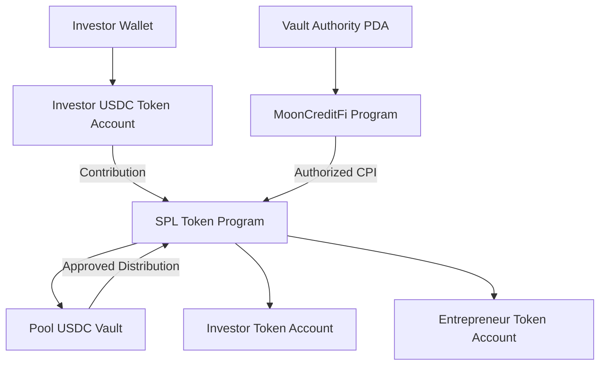

## 4.2 Contribution Transaction Flow

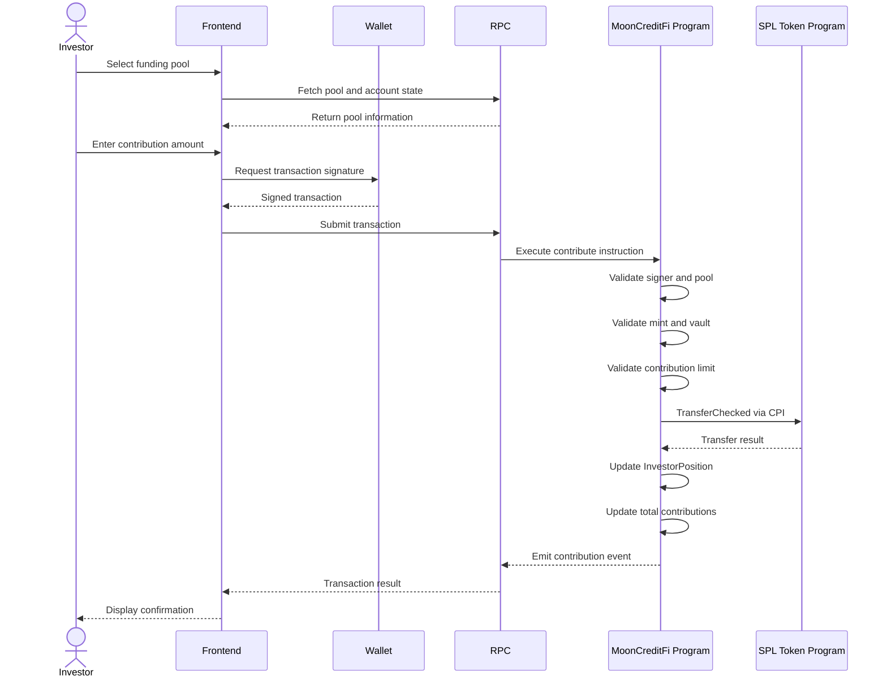

## 4.3 Contribution Validation

The contract should verify:

- Investor authorization.
- Correct pool address.
- Correct USDC mint.
- Correct source token account.
- Correct pool vault.
- Correct vault authority.
- Positive contribution amount.
- Pool status is Open.
- Contribution does not exceed the remaining funding target.

A successful frontend submission is not sufficient proof of a successful contribution. The transaction must be confirmed and the resulting on-chain state checked.

---

# 5. Entrepreneur Financing Workflow

The entrepreneur financing workflow starts with registration and ends with the creation of an approved financing pool.

## 5.1 Entrepreneur Proposal Flowchart

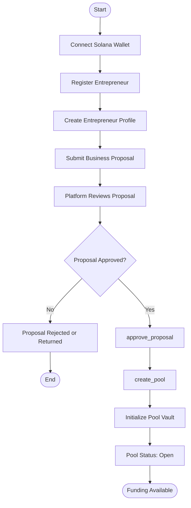

## 5.2 Workflow Instructions

| Step | Instruction | Description |
|---|---|---|
| 1 | `register_entrepreneur` | Registers the entrepreneur |
| 2 | `create_proposal` | Creates a business financing proposal |
| 3 | `approve_proposal` | Authorizes the proposal |
| 4 | `create_pool` | Creates the financing pool and vault |

Proposal review is an administrative process. A proposal must not be treated as approved simply because it exists on-chain.

---

# 6. Investor Funding Workflow

After a pool is created and opened, investors can contribute USDC.

## 6.1 Funding Flowchart

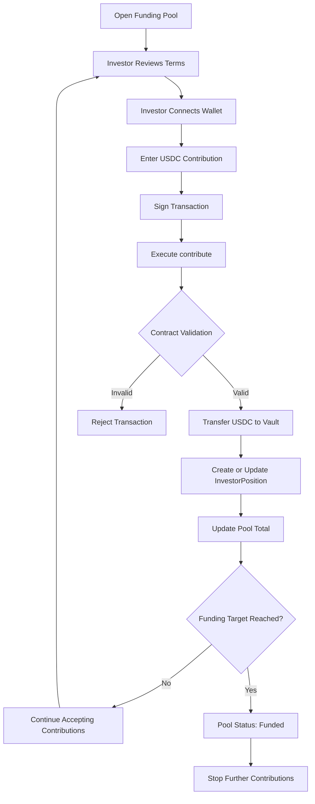

## 6.2 Funding Rules

- Contributions must be greater than zero.
- Contributions must not exceed the funding target.
- Only eligible pools can receive contributions.
- Investor positions must be associated with the correct pool and wallet.
- Contributions must be recorded using integer token base units.

---

# 7. Pool Activation and Capital Disbursement

Once the pool reaches its funding target, the activation and capital disbursement process can begin.

The documented contract flow requires the entrepreneur to activate the pool. Capital disbursement requires the entrepreneur and platform administrator signatures.

## 7.1 Activation Flowchart

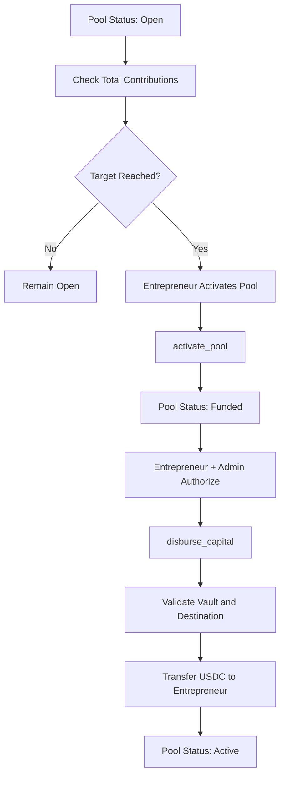

## 7.2 Capital Disbursement Sequence

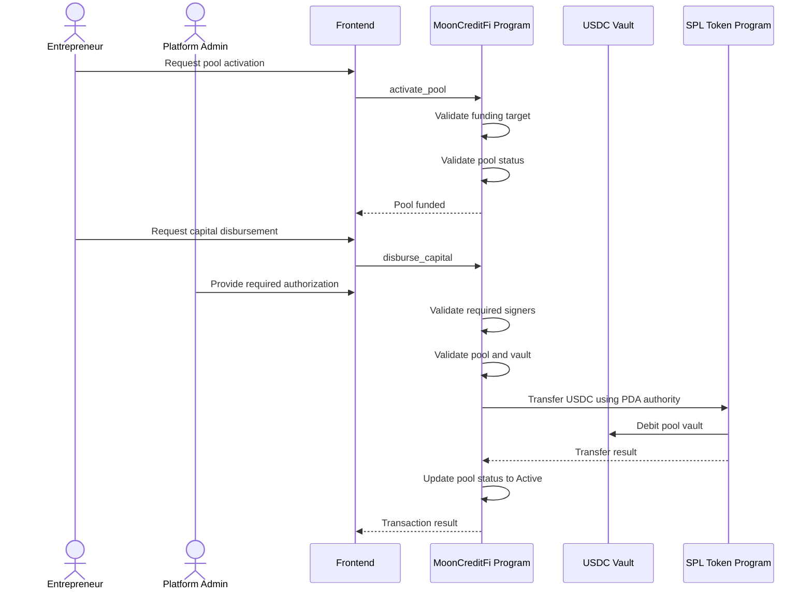

**Financial risk:** Once capital has been transferred to the entrepreneur, the contract cannot guarantee repayment. Capital recovery depends on the business outcome, settlement process, and applicable agreements.

---

# 8. Settlement and Distribution Workflow

After the business activity, the entrepreneur submits settlement information.

The platform administrator reviews the settlement and approves the amount that will be used for distribution.

## 8.1 Settlement Flowchart

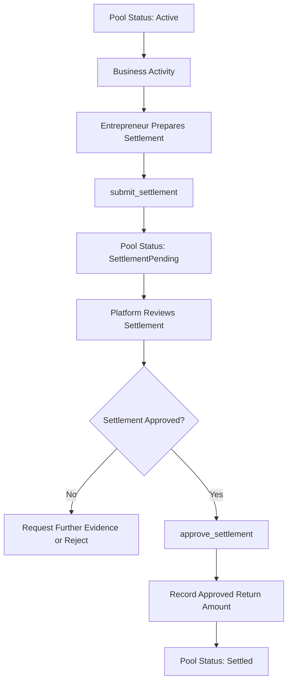

## 8.2 Settlement Sequence

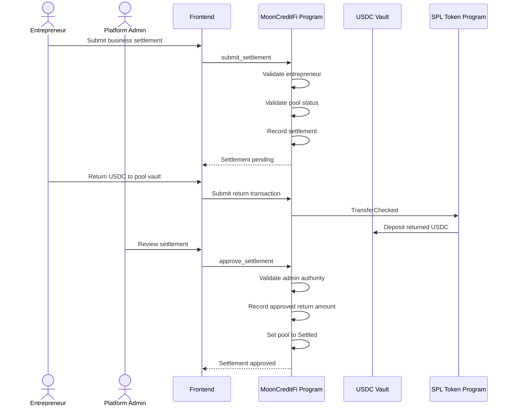

The returned funds must be deposited into the pool vault before they can be distributed. The settlement approval process does not itself prove the accuracy of the business's reported results.

---

# 9. Profit and Loss Distribution

MoonCreditFi uses a Mudarabah-inspired profit-sharing model.

The investor and entrepreneur agree on profit-sharing percentages. Investors provide capital, while the entrepreneur manages the business.

## 9.1 Profit Distribution Flowchart

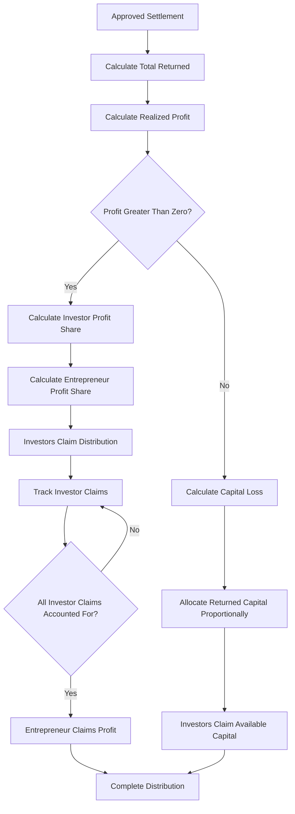

## 9.2 Example: Profit Scenario

Assume:

| Item | Amount |
|---|---:|
| Total investor capital | 10,000 USDC |
| Total returned | 12,000 USDC |
| Realized profit | 2,000 USDC |
| Investor profit share | 70% |
| Entrepreneur profit share | 30% |

Calculation:

```text
Realized Profit = 12,000 - 10,000

Investor Profit = 2,000 × 70%
               = 1,400 USDC

Entrepreneur Profit = 2,000 × 30%
                    = 600 USDC
```

Investors collectively receive 11,400 USDC, while the entrepreneur receives 600 USDC.

These amounts are illustrative and are not guaranteed returns.

## 9.3 Example: Loss Scenario

Assume:

| Item | Amount |
|---|---:|
| Total investor capital | 10,000 USDC |
| Total returned | 8,000 USDC |
| Business loss | 2,000 USDC |

The available 8,000 USDC is distributed among investors in proportion to their respective contributions.

The entrepreneur receives no profit distribution in this example.

Liability for negligence, misconduct, fraud, or contractual breach requires an appropriate determination.

## 9.4 Distribution Sequence

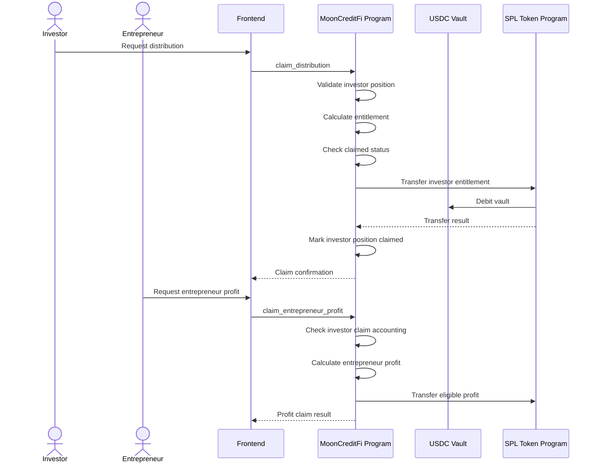

---

# 10. Pool Cancellation and Refund Flow

A pool may be cancelled under the conditions enforced by the contract.

The documented cancellation flow supports cancellation of eligible Open or Funded pools. Investors can then claim eligible refunds.

## 10.1 Cancellation Flowchart

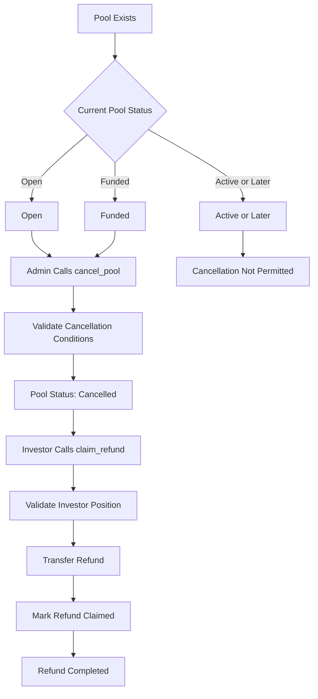

## 10.2 Refund Rules

- Only cancelled pools can process refunds.
- The investor must own the corresponding position.
- Refunds must not exceed the investor's refundable contribution.
- Duplicate refunds must be rejected.
- The pool vault must have sufficient funds.

---

# 11. Complete Mudarabah Lifecycle

This diagram combines the principal financing stages into one view.

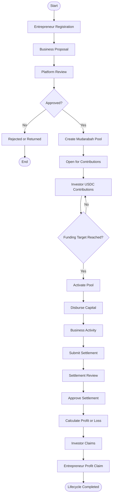

This is the main financing lifecycle. The cancellation and refund path is handled separately.

---

# 12. Smart Contract Instruction Map

| Instruction | Workflow |
|---|---|
| `initialize_platform` | Platform initialization |
| `register_entrepreneur` | Entrepreneur onboarding |
| `create_proposal` | Financing proposal creation |
| `approve_proposal` | Proposal approval |
| `create_pool` | Funding pool creation |
| `contribute` | Investor funding |
| `activate_pool` | Pool activation |
| `disburse_capital` | Capital transfer |
| `submit_settlement` | Settlement submission |
| `approve_settlement` | Settlement approval |
| `claim_distribution` | Investor distribution |
| `claim_entrepreneur_profit` | Entrepreneur profit claim |
| `cancel_pool` | Pool cancellation |
| `claim_refund` | Investor refund |

---

# 13. Transaction Security Architecture

Every financial instruction must validate its accounts and authorization before executing.

## 13.1 Transaction Validation Flow

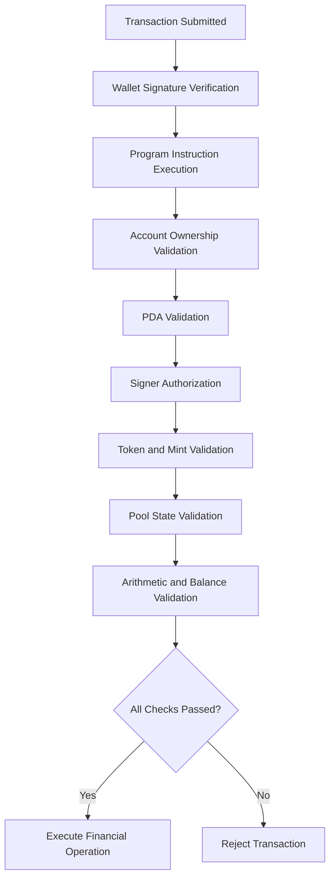

## 13.2 Security Requirements

1. Validate every required signer.
2. Validate every PDA using the correct seeds and bump.
3. Validate the token mint and token program.
4. Validate source and destination token accounts.
5. Prevent duplicate claims.
6. Prevent unauthorized capital disbursement.
7. Use checked integer arithmetic.
8. Enforce valid pool status transitions.
9. Restrict administrative operations.
10. Define upgrade authority governance.

A successful transaction signature alone does not establish that the real-world business activity or settlement is truthful.

---

# 14. Important Architecture Limitations

The diagrams describe the intended contract and application architecture. They do not prove that every component has been implemented or exposed through the frontend.

The following items require explicit verification:

- Whether all documented account fields match the Rust structs.
- Whether the proposed PDA seeds match the deployed program.
- Whether the frontend exposes every contract instruction.
- Whether returned settlement funds are deposited before approval.
- Whether all investor distributions are fully accounted for.
- How unclaimed investor funds are handled.
- How rounding residuals are reconciled.
- Whether emergency pause functionality exists.
- Whether administrative control is protected by multisig governance.

**Critical financial consideration:** The smart contract can enforce how a submitted settlement is distributed. It cannot independently establish whether the entrepreneur's reported business profit or loss is genuine.

---

# 15. Documentation References

- [Solana Core Concepts](https://solana.com/docs/core)
- [Solana Program Derived Addresses](https://solana.com/docs/core/pda)
- [Solana Token Program CPI](https://solana.com/docs/tokens/advanced/cpi)
- [Solana Program Development](https://solana.com/developers/docs/programs)

---

# 16. Conclusion

MoonCreditFi's blockchain architecture connects entrepreneurs, investors, application services, Solana wallets, and the Anchor smart contract.

The core on-chain workflow is:

1. Register entrepreneurs.
2. Submit and approve financing proposals.
3. Create Mudarabah funding pools.
4. Accept investor USDC contributions.
5. Activate fully funded pools.
6. Disburse capital to entrepreneurs.
7. Submit and approve settlements.
8. Distribute realized profit or returned capital.
9. Process eligible investor refunds when pools are cancelled.

The architecture aims to make financial operations transparent, programmable, and verifiable while recognizing that business verification, settlement evidence, legal agreements, and governance require additional off-chain processes.

**MoonCreditFi — Trust Before Capital.**
