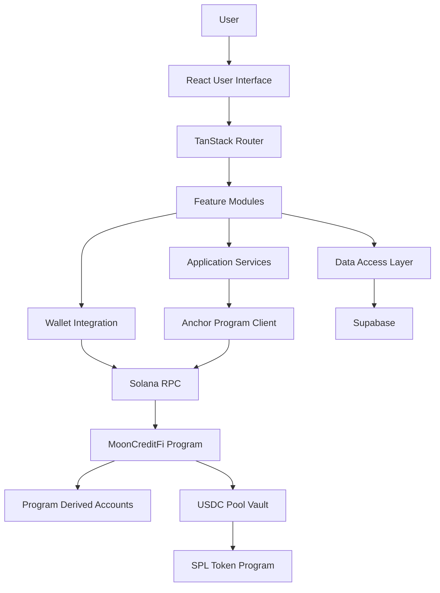
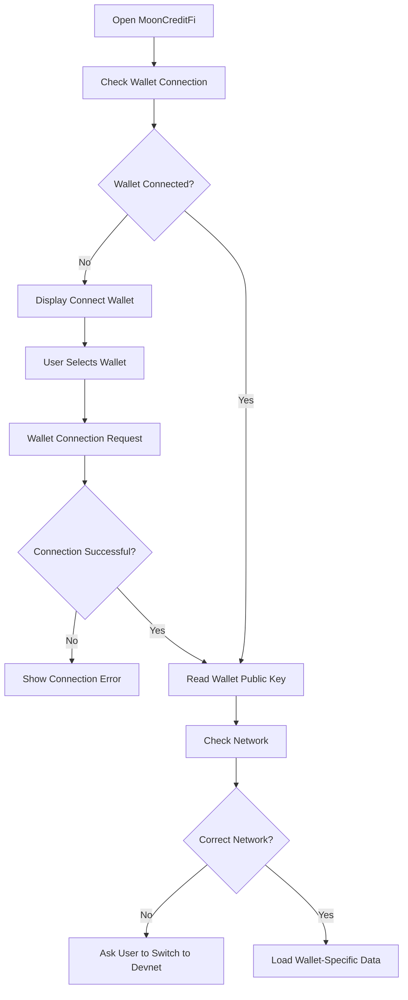
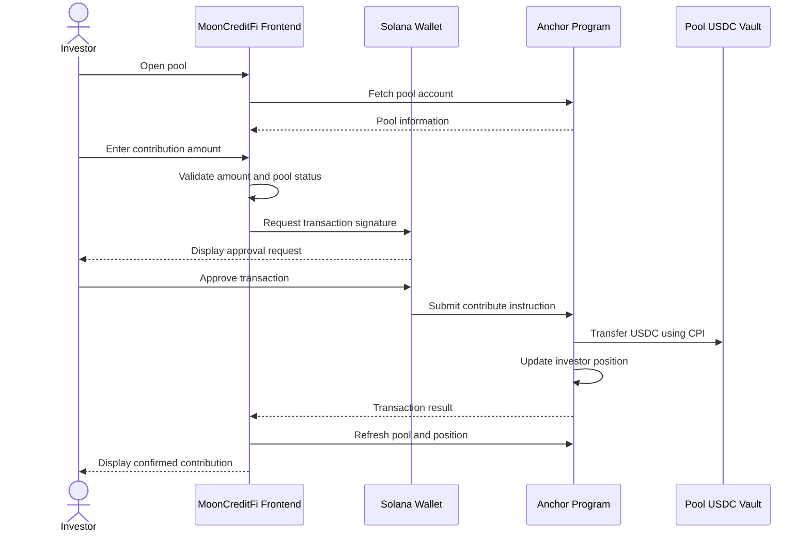
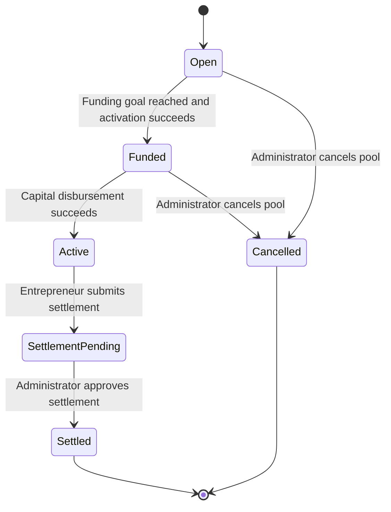
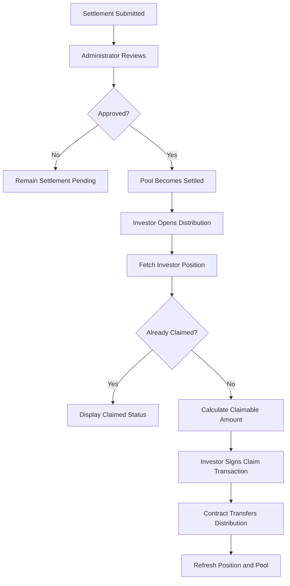

# MoonCreditFi Frontend Documentation

**Document type:** Technical Documentation  
**Project:** MoonCreditFi  
**Blockchain:** Solana  
**Network:** Devnet (current development environment)  
**Frontend status:** Under development  
**Primary purpose:** Investor and entrepreneur interface for Mudarabah-based business financing.

---

## 1. Project Overview

MoonCreditFi is a decentralized business financing platform built around the principles of Mudarabah. It connects entrepreneurs seeking business capital with investors willing to finance approved business proposals.

The frontend provides the interface through which users can:

- Connect their Solana wallets.
- Explore business financing proposals and funding pools.
- Review pool details and funding progress.
- Contribute USDC to eligible pools.
- Monitor their investments and pool activity.
- Follow settlement and profit/loss distribution.
- Manage entrepreneur proposals and financing activities.

The frontend communicates with the MoonCreditFi Anchor smart contract on Solana and uses Supabase for application-level data where configured.

**Important:** The frontend must not independently calculate or declare a transaction successful. On-chain transaction confirmation and account state are the source of truth for blockchain operations.

## 2. Technology Stack

| Technology | Responsibility |
|---|---|
| React 19 | Component-based user interface |
| TypeScript | Type safety |
| Vite 8 | Development and build tooling |
| TanStack Start | Application framework |
| TanStack Router | File-based, type-safe routing |
| Tailwind CSS 4 | Styling and responsive layouts |
| Solana Web3.js | Solana RPC and transaction interaction |
| Anchor 0.30.1 | Smart-contract client integration |
| Solana Wallet Adapter | Wallet connection and signing |
| Supabase | Application database and configured backend services |
| Vitest | Frontend testing |

The current project dependencies also include TanStack Start, TanStack Router, Nitro, and Solana wallet integration packages.

### Architecture decision

The existing application uses the Web3.js and Anchor ecosystem. Keep that integration consistent while stabilizing the current application. Do not introduce a second Solana client stack without a clear migration plan.

Solana's newer Kit ecosystem is an alternative for future development, but it is not necessary to rewrite the current frontend simply because newer libraries exist.

## 3. Frontend Architecture

The frontend follows a layered architecture that separates presentation, application logic, blockchain interaction, and backend data access.



### 3.1 Presentation layer

Responsible for what users see and interact with.

Examples:

- Navigation and dashboard layouts.
- Wallet connection controls.
- Proposal cards and details.
- Funding progress indicators.
- Contribution forms.
- Investment history.
- Transaction status messages.
- Empty, loading, and error states.

Components should not contain complicated PDA derivation, token-transfer logic, or duplicated contract instructions.

### 3.2 Feature layer

Contains the product functionality.

Recommended feature modules:

| Feature | Responsibility |
|---|---|
| Wallet | Connection and wallet state |
| Dashboard | User overview and activity |
| Proposals | Business proposal discovery and management |
| Pools | Pool details and lifecycle |
| Investments | Investor positions and contributions |
| Settlements | Settlement information and approval status |
| Distributions | Investor and entrepreneur claims |
| Activity | Transaction and event history |
| Profile | User and entrepreneur information |

### 3.3 Blockchain service layer

This layer handles all communication with the Solana program.

Recommended responsibilities:

- Initialize the Anchor program client.
- Derive program addresses.
- Fetch program accounts.
- Build instructions.
- Request wallet signatures.
- Submit transactions.
- Confirm transactions.
- Refresh affected account data.
- Decode program errors.

The React components should call service functions rather than constructing raw transactions throughout the application.

### 3.4 Backend and database layer

Supabase can support application-level information such as:

- User profiles.
- Business descriptions and supporting documents.
- Proposal presentation metadata.
- Notifications.
- User preferences.
- Off-chain activity records.

The database must not become the authority for investor balances, pool contributions, settlement amounts, or claim status. Those values must be verified against the relevant on-chain accounts.

## 4. Application Structure

A recommended frontend structure is:

```text
frontend/
├── src/
│   ├── components/
│   │   ├── common/
│   │   ├── layout/
│   │   ├── navigation/
│   │   ├── wallet/
│   │   ├── proposals/
│   │   ├── pools/
│   │   └── investments/
│   │
│   ├── features/
│   │   ├── dashboard/
│   │   ├── proposals/
│   │   ├── pools/
│   │   ├── investments/
│   │   ├── settlements/
│   │   ├── distributions/
│   │   ├── activity/
│   │   └── profile/
│   │
│   ├── hooks/
│   │   ├── useWallet.ts
│   │   ├── useProgram.ts
│   │   └── usePool.ts
│   │
│   ├── lib/
│   │   ├── solana/
│   │   │   ├── connection.ts
│   │   │   ├── provider.tsx
│   │   │   ├── program.ts
│   │   │   ├── pda.ts
│   │   │   └── transactions.ts
│   │   │
│   │   ├── supabase/
│   │   │   ├── client.ts
│   │   │   └── queries.ts
│   │   │
│   │   └── utils/
│   │
│   ├── routes/
│   ├── types/
│   ├── styles/
│   └── router.tsx
│
├── public/
├── tests/
├── .env.example
├── package.json
└── vite.config.ts
```

This is a recommended organizational structure, not a claim that every directory already exists in the current repository.

## 5. Main Application Pages

The following pages define the intended product experience. Their inclusion in this documentation does not establish that every page or feature is already implemented.

### 5.1 Dashboard

**Purpose:** Give users an overview of their MoonCreditFi activities.

Suggested information:

- Connected wallet.
- Total amount invested.
- Active investments.
- Available claims.
- Participating pools.
- Recent transactions.
- Relevant notifications.

Dashboard values must be fetched from their authoritative sources. Do not display fabricated balances or hardcoded investment statistics.

### 5.2 Proposals

**Purpose:** Allow users to discover business financing opportunities.

A proposal should display:

- Business name.
- Business description.
- Funding objective.
- Requested capital.
- Proposed entrepreneur profit share.
- Proposal status.
- Entrepreneur wallet.
- Relevant supporting information.

The interface should distinguish between proposals awaiting approval and proposals approved for pool creation.

### 5.3 Pools

**Purpose:** Allow investors to inspect available financing pools.

A pool details page should include:

- Pool identifier.
- Associated business proposal.
- Entrepreneur wallet.
- Funding goal.
- Total contributions.
- Remaining funding amount.
- Investor count.
- Pool status.
- USDC contribution form.
- Transaction history.

Funding progress should be calculated from on-chain values:

\[
\text{Funding Progress} =
\frac{\text{Total Contributed}}{\text{Funding Goal}} \times 100
\]

The interface must prevent users from submitting an amount that exceeds the remaining funding goal. The smart contract must enforce this restriction independently.

### 5.4 Investments

**Purpose:** Show the connected investor's positions.

Suggested information:

- Pool name or identifier.
- Original contribution.
- Current pool status.
- Settlement information.
- Claim eligibility.
- Amount available to claim.
- Claim transaction status.

A frontend estimate must never be presented as an already-earned or guaranteed return.

### 5.5 Settlements

**Purpose:** Display the outcome of an entrepreneur's business financing activity.

The page should show:

- Amount returned.
- Original pool capital.
- Reported profit or loss.
- Settlement status.
- Approval status.
- Relevant transaction signatures.

The entrepreneur submits settlement information. The platform administrator approves it through the smart contract.

The frontend must clearly distinguish an entrepreneur-submitted settlement from an administrator-approved settlement.

### 5.6 Distributions

**Purpose:** Allow eligible users to claim their share after settlement approval.

The page should show:

- Investor contribution.
- Pool return.
- Calculated distribution.
- Claim status.
- Claim transaction.

Entrepreneur profit claims should be displayed separately from investor claims.

### 5.7 Activity

**Purpose:** Provide a transaction history.

Possible activity types include:

- Proposal creation.
- Proposal approval.
- Pool creation.
- Investor contribution.
- Pool activation.
- Capital disbursement.
- Settlement submission.
- Settlement approval.
- Investor distribution claim.
- Entrepreneur profit claim.
- Pool cancellation.
- Investor refund.

Every blockchain activity should link to its transaction on Solana Explorer.

## 6. Wallet Integration

MoonCreditFi uses Solana wallet integration to allow users to connect wallets and authorize blockchain transactions.

The current development environment is Solana Devnet.

### Wallet connection flow



### Wallet states

The frontend should support these states:

| State | UI behavior |
|---|---|
| Disconnected | Display connect wallet action |
| Connecting | Display loading indicator |
| Connected | Display shortened wallet address |
| Wrong network | Display network warning |
| Transaction pending | Display pending status |
| Transaction confirmed | Display confirmation and refresh data |
| Transaction failed | Display useful error information |

### Network validation

The application must verify that the connected wallet and configured RPC connection use the intended network.

Current development configuration:

```text
Network: Solana Devnet
Program ID: 6LVAYFDRrTHSiHZqMWr4tybZNRi755HsoHgeku985pYx
USDC Mint: 4zMMC9srt5Ri5X14GAgXhaHii3GnPAEERYPJgZJDncDU
Token Program: SPL Token Program
```

These are development configuration values. They must be revalidated before mainnet deployment.

## 7. Smart Contract Integration

The frontend integrates with the MoonCreditFi Anchor program.

### Program instructions

The documented contract exposes the following instruction set:

| Instruction | Frontend responsibility |
|---|---|
| `initializePlatform` | Platform initialization interface, restricted to authorized administration |
| `registerEntrepreneur` | Entrepreneur registration |
| `createProposal` | Submit a business proposal |
| `approveProposal` | Administrator proposal approval |
| `createPool` | Create a pool from an approved proposal |
| `contribute` | Contribute USDC to a pool |
| `activatePool` | Activate a fully funded pool |
| `disburseCapital` | Authorize capital disbursement |
| `submitSettlement` | Submit business settlement |
| `approveSettlement` | Administrator settlement approval |
| `claimDistribution` | Claim investor distribution |
| `claimEntrepreneurProfit` | Claim eligible entrepreneur profit |
| `cancelPool` | Administrator pool cancellation |
| `claimRefund` | Claim a refund from a cancelled pool |

Not every instruction should be accessible to every user. The frontend must check the user's role and the current on-chain account state before displaying or enabling privileged actions.

### Program client initialization

The program client should be initialized in one reusable service module.

Illustrative TypeScript structure:

```ts
import { AnchorProvider, Program } from "@coral-xyz/anchor";
import { Connection } from "@solana/web3.js";

// Import the generated MoonCreditFi IDL and type.
// Configure the program ID from the project's
// validated deployment configuration.

export function createMoonCreditFiProgram(
  connection: Connection,
  wallet: AnchorProvider["wallet"],
  idl: any
) {
  const provider = new AnchorProvider(
    connection,
    wallet,
    AnchorProvider.defaultOptions()
  );

  return new Program(idl, provider);
}
```

This is an integration pattern, not a complete drop-in implementation. The actual IDL type, constructor compatibility, wallet interface, and program address must match the generated artifacts and installed Anchor version.

### Program Derived Accounts

The frontend must derive the same PDAs as the Rust program.

Documented seeds:

| Account | Seed |
|---|---|
| Platform configuration | `config` |
| Entrepreneur profile | `entrepreneur` + entrepreneur public key |
| Business proposal | `proposal` + entrepreneur public key + business ID |
| Mudarabah pool | `pool` + proposal public key |
| Vault | `vault` + pool public key |
| Investor position | `position` + pool public key + investor public key |
| Settlement | `settlement` + pool public key |

The frontend must use the exact seeds, account order, and program ID implemented in the deployed Rust program. Any mismatch will derive the wrong address and cause transaction failures.

## 8. Investor Contribution Workflow

The contribution process is one of the most important frontend interactions.



### Frontend validation

Before requesting a wallet signature, verify:

1. Wallet is connected.
2. Wallet is using the correct network.
3. Pool exists.
4. Pool status is `Open`.
5. Contribution amount is greater than zero.
6. Contribution does not exceed the remaining funding amount.
7. Investor has sufficient USDC.
8. The required token account and program accounts exist or can be initialized as required.

The smart contract remains responsible for enforcing all critical rules.

### Amount precision

The development USDC mint uses six decimal places.

Convert user-entered amounts into integer base units before passing them to the contract.

\[
\text{Base Units} = \text{USDC Amount} \times 10^6
\]

Avoid JavaScript floating-point arithmetic for token amounts. Use integer-safe conversion, such as `BN` or `bigint`, consistent with the Anchor instruction types.

## 9. Mudarabah Pool Lifecycle

The frontend must display the lifecycle based on the actual on-chain status.



### Status descriptions

| Status | Meaning |
|---|---|
| `Open` | Pool accepts contributions |
| `Funded` | Funding goal reached and pool activation completed |
| `Active` | Capital has been disbursed |
| `SettlementPending` | Entrepreneur submitted settlement for approval |
| `Settled` | Settlement approved by administrator |
| `Cancelled` | Pool cancelled and eligible investors can claim refunds |

**Important contract behavior:** The documented `activatePool` instruction moves the pool from `Open` to `Funded`. The `disburseCapital` instruction requires the entrepreneur and administrator signatures and moves the pool to `Active`.

Do not implement a different lifecycle in the frontend.

## 10. Profit and Loss Distribution Interface

After an administrator approves a settlement, eligible investors can claim their distributions.

The documented contract uses pro-rata distribution.

For a profitable pool:

\[
\text{Investor Profit Share} =
\text{Total Profit}
\times
\frac{\text{Investor Contribution}}{\text{Total Contributions}}
\times
\frac{10000 - \text{Entrepreneur Profit BPS}}{10000}
\]

For a loss-making pool, the contract distributes the returned capital proportionally to investor contributions.

The frontend should display the figures returned or derived from verified on-chain state, with clear labels for:

- Original contribution.
- Total returned capital.
- Investor profit share.
- Entrepreneur profit share.
- Amount claimable.
- Amount already claimed.

The interface must not promise a fixed return or imply that investors are protected from business losses.

### Claim sequence



The contract currently requires all investor positions to be claimed before the entrepreneur can claim their profit. This dependency must be reflected in the UI. It also means an investor who does not claim can delay the entrepreneur's claim, even if the investor's payout is zero.

## 11. Supabase Integration

Supabase is intended for application-level data and services.

### Suggested data responsibilities

| Data | Recommended source |
|---|---|
| Wallet public key | Connected wallet |
| Pool status | Solana program account |
| Pool contributions | Solana program account |
| Investor position | Solana program account |
| Settlement approval | Solana program account |
| Business description | Supabase, where configured |
| User profile metadata | Supabase |
| Supporting documents | Supabase Storage, where configured |
| Notifications | Backend/Supabase, where configured |
| Transaction signature | Solana transaction |

### Authentication warning

The current development work has encountered missing `user_wallets` and `auth_nonces` tables, as well as failing SIWS nonce and verification endpoints.

Therefore, wallet-based application authentication must be treated as **not enabled until the backend is correctly configured and tested**.

Wallet connection is not the same as secure application authentication.

A proper Sign-In With Solana (SIWS) flow should:

1. Request a server-generated nonce.
2. Construct a message containing the domain, wallet address, nonce, and expiration.
3. Ask the wallet to sign the message.
4. Send the signed message to the backend.
5. Verify the signature and nonce server-side.
6. Create or refresh the authenticated session.
7. Reject expired or reused nonces.

Do not silently replace this with a wallet-address-only login.

## 12. Environment Configuration

Create a frontend `.env` file using the required configuration values.

```dotenv
VITE_SOLANA_NETWORK=devnet
VITE_SOLANA_RPC_URL=https://api.devnet.solana.com

VITE_MOONCREDITFI_PROGRAM_ID=6LVAYFDRrTHSiHZqMWr4tybZNRi755HsoHgeku985pYx
VITE_USDC_MINT=4zMMC9srt5Ri5X14GAgXhaHii3GnPAEERYPJgZJDncDU

VITE_SUPABASE_URL=https://your-project.supabase.co
VITE_SUPABASE_PUBLISHABLE_KEY=your-public-publishable-key
```

The variable names for Solana configuration are recommended conventions and must match the actual application code.

Never put the Supabase service-role key, private keys, wallet seed phrases, or other server secrets in frontend environment variables. Vite exposes variables prefixed with `VITE_` to the browser.

## 13. Transaction Handling and Error Management

Every transaction flow should have explicit states.

Recommended transaction lifecycle:

```text
idle
  |
  v
validating
  |
  v
awaiting_wallet_approval
  |
  v
submitting
  |
  v
confirming
  |
  +----> confirmed
  |
  +----> failed
```

The frontend should:

- Disable duplicate submission while a transaction is pending.
- Display the transaction signature when available.
- Wait for confirmation before showing success.
- Refresh affected account data after confirmation.
- Provide a Solana Explorer link.
- Display useful error messages without exposing sensitive information.

Common errors to handle:

| Error | Expected frontend response |
|---|---|
| Wallet disconnected | Ask user to reconnect |
| Wrong network | Ask user to switch networks |
| Insufficient USDC | Explain the required balance |
| Pool is not open | Refresh pool state |
| Funding goal exceeded | Show remaining funding amount |
| Invalid PDA | Report configuration or account mismatch |
| Transaction rejected | Explain that the user cancelled signing |
| Transaction failed | Display failure and allow retry where appropriate |
| Settlement not approved | Disable claim action |
| Already claimed | Display completed claim status |

Do not convert every failure into a generic "Something went wrong" message. Preserve useful program errors and transaction details.

## 14. Security Requirements

The frontend is not a security boundary. All critical checks must be enforced by the smart contract or trusted backend.

Required frontend practices:

- Never request or store wallet private keys.
- Never request seed phrases.
- Never hardcode administrator signing authority.
- Validate user input before constructing transactions.
- Verify program ID and network configuration.
- Derive PDAs using the correct program ID and seeds.
- Verify token mint and token program.
- Display the exact transaction purpose before signature requests.
- Do not trust user-submitted balances or pool statuses.
- Do not expose Supabase service-role credentials.
- Do not assume a connected wallet is authenticated to the application.
- Refresh data after successful transactions.
- Avoid showing mock balances as real blockchain data.

## 15. Testing Strategy

The frontend must be tested independently and against the deployed Devnet contract.

### Unit tests

Test:

- Token amount conversion.
- USDC decimal handling.
- PDA derivation.
- Funding progress calculations.
- Remaining funding calculations.
- Pool status labels.
- Profit and loss display calculations.
- Claim eligibility logic.
- Transaction state transitions.

### Component tests

Test:

- Wallet connection controls.
- Proposal cards.
- Pool details.
- Contribution forms.
- Investor position cards.
- Settlement views.
- Claim buttons.
- Error and loading states.

### Integration tests

Test complete user journeys:

| Test | Expected result |
|---|---|
| Connect wallet | Wallet address is displayed |
| Read pool | Correct on-chain pool data is displayed |
| Create proposal | Proposal account is created |
| Approve proposal | Approved state is reflected |
| Create pool | Pool account and vault are created |
| Contribute USDC | Tokens move into the pool vault |
| Activate pool | Pool status changes to `Funded` |
| Disburse capital | Capital is transferred and status becomes `Active` |
| Submit settlement | Settlement is recorded and status becomes `SettlementPending` |
| Approve settlement | Pool status becomes `Settled` |
| Claim investor distribution | Investor receives the correct amount |
| Claim entrepreneur profit | Eligible entrepreneur receives the correct amount |
| Cancel pool | Eligible investors can claim refunds |

### Critical financial test cases

Do not limit testing to a successful profitable pool.

Test:

1. Pool reaches exactly its funding goal.
2. Contribution exceeds the remaining amount.
3. Pool is cancelled before funding.
4. Pool is cancelled after reaching its goal but before disbursement.
5. Business returns less than the contributed capital.
6. Business returns exactly the contributed capital.
7. Business returns more than the contributed capital.
8. Investor claims twice.
9. Investor never claims.
10. Multiple investors claim in different orders.
11. Distribution rounding leaves residual tokens.
12. Entrepreneur attempts to claim before all investor claims are completed.

## 16. Development and Deployment

### Local development

From the frontend directory:

```bash
npm install
npm run dev
```

### Production build

```bash
npm run build
```

### Preview

```bash
npm run preview
```

### Lint

```bash
npm run lint
```

The current application uses TanStack Start alongside Vite and Nitro. Verify the actual production build output and deployment adapter before selecting hosting configuration. A standard static Vite deployment should not be assumed to be sufficient for a TanStack Start application using server-side functionality.

For a full-stack TanStack Start deployment, the hosting configuration must correctly support its server output and runtime.

## 17. Frontend Completion Checklist

### Application foundation

- [ ] Application starts successfully.
- [ ] Production build completes.
- [ ] Routes load correctly.
- [ ] Responsive layouts work.
- [ ] Loading and error states are implemented.

### Wallet integration

- [ ] Phantom connection works.
- [ ] Other supported wallets are detected.
- [ ] Wallet disconnection works.
- [ ] Devnet is correctly configured.
- [ ] Wrong-network state is handled.
- [ ] Transaction signatures are requested correctly.

### Smart contract integration

- [ ] Correct IDL is integrated.
- [ ] Program ID matches the deployed contract.
- [ ] PDA derivations match Rust.
- [ ] Program accounts load correctly.
- [ ] USDC token accounts are handled correctly.
- [ ] Contributions work.
- [ ] Pool lifecycle is reflected correctly.
- [ ] Settlement and distribution flows work.
- [ ] Refund flow works.

### Backend integration

- [ ] Supabase connection works.
- [ ] Required database tables exist.
- [ ] Database access policies are configured.
- [ ] SIWS nonce generation works.
- [ ] SIWS signature verification works.
- [ ] Session management is tested.

### Production readiness

- [ ] No fabricated financial data.
- [ ] No exposed secrets.
- [ ] No duplicate transaction submissions.
- [ ] Financial edge cases are tested.
- [ ] Transaction confirmation is handled correctly.
- [ ] Mainnet configuration is independently verified.
- [ ] Security review is completed.

## 18. Final Architecture Principle

MoonCreditFi's frontend should be a reliable interface to the protocol, not a second implementation of the protocol's financial logic.

The responsibilities should remain clear:

- **Frontend:** User experience, forms, data presentation, wallet interaction, and transaction initiation.
- **Smart contract:** Pool rules, contribution validation, capital movement, settlement state, and distribution enforcement.
- **Backend:** Application authentication, user metadata, notifications, and other trusted off-chain services.
- **Solana:** Verifiable transaction execution and on-chain account state.

The most important engineering requirement is consistency between the frontend, Anchor IDL, deployed program, and backend. If these four parts disagree, the application may look functional while transactions fail or financial information becomes misleading.

---

## References

- Solana frontend development: https://solana.com/docs/frontend
- Solana React wallet integration: https://solana.com/developers/cookbook/wallets/connect-wallet-react
- TanStack Start documentation: https://tanstack.com/start/latest
- TanStack Start hosting guide: https://tanstack.com/start/latest/docs/framework/react/guide/hosting

**Documentation status:** This document describes the intended frontend architecture and integration requirements. Verify every implementation claim against the current frontend repository, backend configuration, generated IDL, and deployed Devnet program before treating the corresponding feature as complete.
