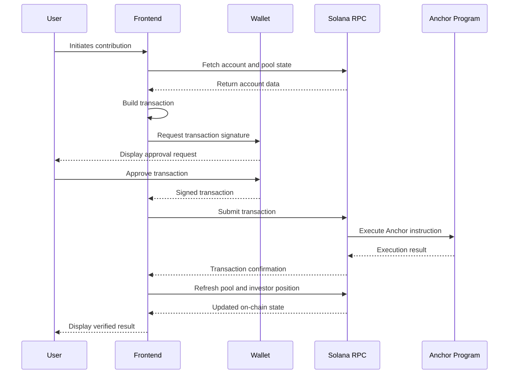

# MoonCreditFi Frontend Documentation

**Trust Before Capital**

Technical documentation for the MoonCreditFi frontend application.

| Property | Details |
|---|---|
| Project | MoonCreditFi |
| Module | Frontend |
| Framework | React |
| Language | TypeScript |
| Styling | Tailwind CSS |
| Authentication | Sign-In with Solana (SIWS) |
| Blockchain | Solana |
| Smart Contracts | Rust + Anchor |
| Backend | Supabase |
| Initial Network | Solana Devnet |
| Status | Development |

---

# 1. Introduction

## 1.1 Overview

The MoonCreditFi frontend is the primary user interface through which entrepreneurs and investors interact with the MoonCreditFi ecosystem.

It provides a unified application experience for:

- Connecting Solana wallets.
- Authenticating users through Sign-In with Solana.
- Creating and managing user profiles.
- Registering business profiles.
- Submitting business financing proposals.
- Discovering and reviewing funding opportunities.
- Contributing USDC to financing pools.
- Tracking investments and transactions.
- Monitoring business verification and settlement progress.

The frontend connects the user interface to the backend infrastructure and Solana smart contracts.

Its primary responsibility is to provide a secure, intuitive, and transparent experience while ensuring that sensitive operations are validated by the backend or blockchain rather than trusted solely to the browser.

## 1.2 Core frontend objectives

1. Provide secure wallet-based authentication.
2. Support both investor and entrepreneur user roles.
3. Allow entrepreneurs to manage multiple businesses.
4. Provide investors with clear funding opportunities.
5. Display accurate transaction and investment information.
6. Integrate with the MoonCreditFi Anchor program.
7. Communicate with Supabase backend services.
8. Provide transparent business and funding status updates.

---

# 2. Frontend Architecture

## 2.1 High-level architecture

The MoonCreditFi frontend follows a modular client application architecture.

The application is divided into five major layers:

1. Presentation Layer
2. Application Logic Layer
3. Authentication and Wallet Layer
4. Data Access Layer
5. Blockchain Integration Layer

### Architecture diagram



[Mermaid source](diagrams/frontend-docs-01.mmd)

### Architecture explanation

**Presentation Layer**

Responsible for rendering pages, dashboards, forms, reusable components, loading states, and notifications.

**Application Logic Layer**

Handles application workflows, role-based navigation, form validation, business rules, and coordination between services.

**Authentication and Wallet Layer**

Manages wallet connection, SIWS authentication, session state, and wallet-related interactions.

**Data Access Layer**

Communicates with Supabase and backend services to retrieve and update user profiles, businesses, proposals, and other application data.

**Solana Integration Layer**

Handles blockchain interactions, transaction construction, wallet signing, transaction submission, and confirmation.

Important: The frontend must never independently decide that a financial transaction is successful merely because the wallet returned a signature. It should verify the transaction's actual confirmation and relevant on-chain state.

---

# 3. Recommended Project Structure

The frontend should use a modular, feature-oriented structure.

```text
mooncreditfi-frontend/
│
├── public/
│   ├── images/
│   ├── icons/
│   └── logo/
│
├── src/
│   │
│   ├── app/
│   │   ├── App.tsx
│   │   ├── router.tsx
│   │   └── providers/
│   │       ├── WalletProvider.tsx
│   │       ├── AuthProvider.tsx
│   │       └── QueryProvider.tsx
│   │
│   ├── components/
│   │   ├── ui/
│   │   ├── layout/
│   │   ├── navigation/
│   │   ├── forms/
│   │   └── feedback/
│   │
│   ├── features/
│   │   ├── authentication/
│   │   ├── profiles/
│   │   ├── businesses/
│   │   ├── investors/
│   │   ├── entrepreneurs/
│   │   ├── proposals/
│   │   ├── funding-pools/
│   │   ├── investments/
│   │   ├── transactions/
│   │   └── settlements/
│   │
│   ├── hooks/
│   │
│   ├── services/
│   │   ├── supabase/
│   │   ├── api/
│   │   ├── wallet/
│   │   └── solana/
│   │
│   ├── lib/
│   │   ├── constants/
│   │   ├── validation/
│   │   ├── utilities/
│   │   └── formatters/
│   │
│   ├── types/
│   │
│   ├── styles/
│   │
│   └── main.tsx
│
├── .env.example
├── package.json
├── tsconfig.json
└── README.md
```

This is the recommended structure. Adapt it to the existing repository rather than restructuring a working application without a reason.

---

# 4. Authentication Architecture

## 4.1 Sign-In with Solana

MoonCreditFi uses wallet-based authentication through Sign-In with Solana (SIWS).

A wallet address alone is not sufficient authentication.

The user must prove control of the wallet by signing a server-generated authentication message.

### Authentication flowchart



[Mermaid source](diagrams/frontend-docs-02.mmd)

## 4.2 Authentication responsibilities

The frontend is responsible for:

- Connecting the user's wallet.
- Requesting an authentication challenge.
- Building the SIWS message.
- Requesting the wallet signature.
- Sending the signature to the backend.
- Handling successful or failed authentication.
- Maintaining application authentication state.
- Redirecting authenticated users.

The backend is responsible for:

- Generating secure nonces.
- Ensuring nonce uniqueness and expiration.
- Verifying wallet signatures.
- Validating SIWS message contents.
- Preventing replay attacks.
- Creating and managing secure sessions.

The wallet signature proves control of a wallet. It does not establish the user's real-world identity.

## 4.3 Role management

MoonCreditFi supports two primary roles:

**Entrepreneur**
- Create business profiles.
- Submit financing proposals.
- Manage funding applications.
- Monitor funding progress.
- Submit business settlement information.

**Investor**
- Discover available financing opportunities.
- Review business proposals.
- Contribute USDC to funding pools.
- Monitor investment positions.
- Review settlement and distribution records.

A user may have both roles.

Role selection must not be treated as a security boundary. Every sensitive operation must also be authorized by the backend or smart contract.

---

# 5. Application Navigation

The application should provide a consistent navigation structure.

## 5.1 Public pages

| Route | Purpose |
|---|---|
| `/` | Landing page |
| `/about` | About MoonCreditFi |
| `/how-it-works` | Explain the platform |
| `/opportunities` | Public financing opportunities, if enabled |
| `/docs` | Developer documentation |
| `/privacy` | Privacy policy |
| `/terms` | Terms of service |

## 5.2 Authenticated application pages

| Route | Purpose |
|---|---|
| `/app` | Main dashboard |
| `/app/profile` | User profile |
| `/app/businesses` | Business management |
| `/app/businesses/new` | Create business profile |
| `/app/proposals` | Financing proposals |
| `/app/investments` | Investor investments |
| `/app/opportunities` | Available funding opportunities |
| `/app/pools/:poolId` | Funding pool details |
| `/app/transactions` | Transaction history |
| `/app/settlements` | Settlement information |
| `/app/settings` | Account settings |

Routes are proposed examples. The final paths must match the actual router configuration.

## 5.3 Navigation flow



[Mermaid source](diagrams/frontend-docs-03.mmd)

---

# 6. Entrepreneur Dashboard

The entrepreneur dashboard enables users to manage their businesses and financing activities.

## 6.1 Main features

- Entrepreneur profile.
- Multiple business profiles.
- Business registration.
- Business verification status.
- Financing proposal creation.
- Proposal submission status.
- Funding pool tracking.
- Capital disbursement status.
- Settlement submission.
- Transaction history.

## 6.2 Business registration flow



[Mermaid source](diagrams/frontend-docs-04.mmd)

A verified business should not automatically mean that a financing proposal is approved. Business verification and financing approval are separate decisions.

## 6.3 Financing proposal workflow

An entrepreneur should be able to:

1. Select an existing business.
2. Enter the financing amount.
3. Explain the business purpose.
4. Define the proposed business activity.
5. Submit supporting information.
6. Define the proposed profit-sharing ratio, subject to platform policy.
7. Submit the proposal for review.
8. Track approval or rejection.

The frontend should display the proposal's actual backend or on-chain status, not a locally fabricated status.

---

# 7. Investor Dashboard

The investor dashboard provides access to financing opportunities and investment information.

## 7.1 Main features

- Investor profile.
- Available funding opportunities.
- Business information.
- Proposal details.
- Funding targets.
- Funding progress.
- USDC contribution interface.
- Investment history.
- Transaction records.
- Settlement information.
- Distribution history.

## 7.2 Investor journey



[Mermaid source](diagrams/frontend-docs-05.mmd)

## 7.3 Investment transparency

Every investment interface should clearly communicate:

- Business receiving funding.
- Pool funding target.
- Total amount raised.
- Remaining funding amount.
- Investor's contribution.
- Agreed profit-sharing terms.
- Pool status.
- Transaction signature.
- Network.
- Relevant risk disclosures.

Never present projected profit as guaranteed profit.

---

# 8. Solana Wallet Integration

## 8.1 Wallet responsibilities

The frontend integrates with supported Solana wallets.

Wallet integration is used for:

- Wallet connection.
- SIWS authentication.
- Transaction signing.
- USDC contributions.
- Blockchain transaction confirmation.
- Viewing wallet-related information.

The frontend should not request or store wallet private keys or seed phrases.

## 8.2 Wallet transaction flow



[Mermaid source](diagrams/frontend-docs-06.mmd)

## 8.3 Transaction states

The frontend should support these states:

| State | Meaning |
|---|---|
| Idle | No transaction initiated |
| Preparing | Building transaction |
| Awaiting Signature | Waiting for wallet approval |
| Submitted | Transaction sent to RPC |
| Confirming | Waiting for confirmation |
| Confirmed | Transaction confirmed at the selected commitment level |
| Failed | Transaction execution failed |
| Expired | Transaction could not be confirmed before expiry |

A transaction signature alone does not establish successful execution.

The frontend must also handle RPC timeouts, wallet rejection, insufficient balance, blockhash expiration, and program errors.
